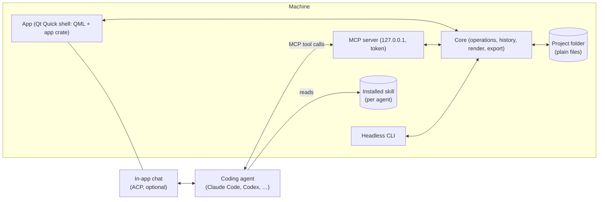
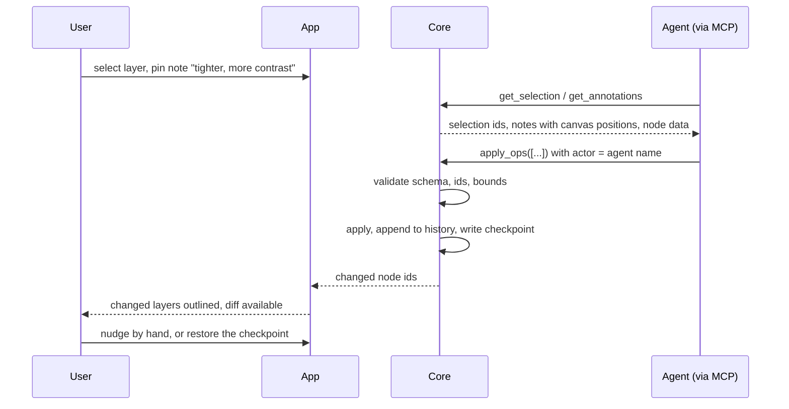

# Architecture

> **Status: Partially implemented.** `core`, `render`, `store`, `agent`, `cli` and the Qt shell (`app`) exist under `crates/` and are tested. `media` (video) and the in-app chat are design only. Cargo packages are `opendesigner-<name>`, library names `od_<name>`.

## The problem this solves

GitNotēs and OpenMedia generate their store and web assets by telling a coding agent, in a terminal, what to draw. The agent writes HTML and a render script (see [Store Assets](./store-assets.md)), the user reads the PNGs and types corrections. Three costs follow: position and size are described in words, the agent cannot see what the user is pointing at, and an edit cannot be partly kept or undone.

OpenDesigner is the missing surface: a canvas and a timeline where the user's *pointing* is part of the conversation, and the agent's *changes* are objects the user can inspect, nudge and revert.

## Overview

Three trust zones:

| Zone | What runs there | Trust |
|------|-----------------|-------|
| **App** | The Qt shell (QML and the `app` crate), the document in memory, the render pipeline | Trusted. Owns the document. |
| **Core** | `core` crate: node model, operations, history, validation, export | Trusted. The only code that mutates a document. |
| **Agents and files** | Coding agents (Claude Code, Codex, …), project files, imported media, anything on the network | **Untrusted.** Reaches the document only through validated operations. |

## The central rule: the core is UI-agnostic

OpenCut's rewrite states it as a principle: business logic lives in Rust, and each app is a UI shell that owns rendering and interaction but never logic. We adopt it, with Qt as the shell. The Qt app, the MCP server and the headless CLI are three front ends over one set of operations. Consequences:

- Anything an agent can do, a person can do in the GUI, and the reverse for editing operations; the GUI has no private write path.
- Batch and CI renders (`opendesigner export --preset app-store-iphone-6.9`) need no window and no browser.
- The renderer can be golden-tested without a GPU window ([Testing](./development-guide.md#testing)).

## Crates

| Crate | Responsibility | Depends on Qt? | Status |
|-------|----------------|----------------|--------|
| `core` | Node model, validated operations, history/checkpoints, project I/O, annotations, workspace and guidance, geometry (bounds, hit tests), panel views ([Document Format](./document-format.md)) | no | built |
| `render` | CPU rasterizer and PNG export: frames, groups, rectangles, ellipses, text (shaped, wrapped, aligned; one style per node) and images (PNG, JPEG, WebP from `media/`; cover, contain, fill; rounded corners; cached decode); an image it cannot read is reported, not dropped silently | no | partial |
| `store` | Export presets and validation ([Store Assets](./store-assets.md)); device frames and panoramas are not built | no | partial |
| `agent` | MCP server and tools, token, skill generator and installer ([Agent Integration](./agent-integration.md)); the ACP client is not built | no | built (MCP, skill) |
| `cli` | Headless commands over the same operations | no | built |
| `app` | The Qt Quick editor: the `Editor` QObject, the Qt-free `EditorState`, the QML ([Qt Desktop](./qt-desktop.md#layers)) | **yes** | built |
| `media` | Decode/encode, FFmpeg ([Video Editing](./video-editing.md)) | no | not started |

`app` is the only crate that touches Qt, and the only one that may contain `unsafe` (generated FFI). If the on-screen canvas and `render` disagree, `render` is right: export is the product, and the canvas view is a preview of it (today the canvas *is* the `render` output, so they cannot disagree; see [the open question](./roadmap.md#open-questions) on a second rasterizer).

## Data flow of one agent edit

## Concurrency model

The document is owned by one `Workspace` inside the app process, behind an `Arc<Mutex<…>>`. The Qt UI thread (through `EditorState`) and the MCP server's handler (on its own threads) both lock it for the duration of one call, so operations from an agent and from the user interleave at operation granularity, never inside one. The MCP server runs in the app process, so the app must be running for agents to connect; when an agent changes the document its change hook queues a call onto the Qt thread (`qt_thread().queue`), which records the touched nodes for the outline and republishes the snapshot. There is no merge between a drag in progress and an agent edit: the drag is only a ghost until the gesture commits as one operation, and the agent's operations are validated against whatever state the document is in at the moment they run, so a conflicting one is rejected with a reason the agent receives.

## Platforms

macOS, Windows, Linux, on whatever Qt 6 supports there ([Qt Desktop](./qt-desktop.md#platform-requirements)). No iOS or Android build is planned; the products are made *for* those stores, not *on* them.

## Non-goals

- A web or mobile version.
- Real-time multi-user collaboration. Projects are files; use Git. (Revisit after Phase 6.)
- A hosted generation or rendering service. Generative media comes from the user's own agent or provider.
- Replacing a full NLE or a full Figma. Scope is store, marketing and web assets and short videos.
