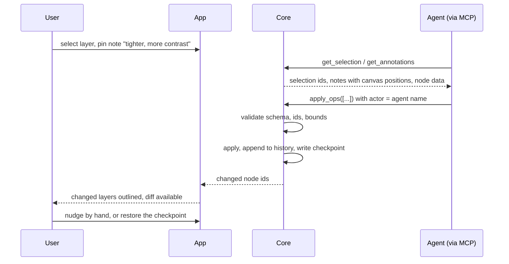

# Architecture

> **Status: Partially implemented.** `core`, `render`, `store` and `cli` exist under `crates/` and are tested; `agent`, `bridge` and the Qt shell (`app/`) are design only. Crate names below are the real ones for the built crates (Cargo packages are `opendesigner-<name>`, library names `od_<name>`).

## The problem this solves

GitNotēs and OpenMedia generate their store and web assets by telling a coding agent, in a terminal, what to draw. The agent writes HTML and a render script (see [Store Assets](./store-assets.md)), the user reads the PNGs and types corrections. Three costs follow: position and size are described in words, the agent cannot see what the user is pointing at, and an edit cannot be partly kept or undone.

OpenDesigner is the missing surface: a canvas and a timeline where the user's *pointing* is part of the conversation, and the agent's *changes* are objects the user can inspect, nudge and revert.

## Overview

Three trust zones:

| Zone | What runs there | Trust |
|------|-----------------|-------|
| **App** | The Qt shell (C++/QML), the `bridge` crate, the document in memory, the render pipeline | Trusted. Owns the document. |
| **Core** | `core` crate: node model, operations, history, validation, export | Trusted. The only code that mutates a document. |
| **Agents and files** | Coding agents (Claude Code, Codex, …), project files, imported media, anything on the network | **Untrusted.** Reaches the document only through validated operations. |

## The central rule: the core is UI-agnostic

OpenCut's rewrite states it as a principle: business logic lives in Rust, and each app is a UI shell that owns rendering and interaction but never logic. We adopt it, with Qt as the shell. The Qt app, the MCP server and the headless CLI are three front ends over one set of operations. Consequences:

- Anything an agent can do, a person can do in the GUI, and the reverse for editing operations; the GUI has no private write path.
- Batch and CI renders (`opendesigner export --preset app-store-iphone-6.9`) need no window and no browser.
- The renderer can be golden-tested without a GPU window ([Testing](./development-guide.md#testing)).

## Intended crates

| Crate | Responsibility | Depends on Qt? |
|-------|----------------|----------------|
| `core` | Node model, operations, validation, history/checkpoints, project I/O ([Document Format](./document-format.md)) | no |
| `render` | Rasterize a document to pixels on the CPU/GPU for export and goldens: paths, text shaping, images, effects | no |
| `store` | Export presets, device frames, panorama slicing, spec validation ([Store Assets](./store-assets.md)) | no |
| `media` | Decode/encode, FFmpeg bindings and toolchain manifest ([Video Editing](./video-editing.md)) | no |
| `agent` | MCP server, tool schemas, skill installer and its per-agent target table, ACP client ([Agent Integration](./agent-integration.md)) | no |
| `bridge` | `cxx-qt` QObjects and list models exposing `core` to QML ([Qt Desktop](./qt-desktop.md#layers)) | **yes** |
| `cli` | Headless commands over the same operations | no |

Outside Cargo, `app/` holds the C++ and QML shell: bootstrap, custom canvas and timeline items, panels, theme, platform integration ([Qt Desktop](./qt-desktop.md)). `bridge` and `app/` are the only code that touches Qt. If the on-screen canvas and `render` disagree, `render` is right: export is the product, and the canvas view is a live preview of it (see [the open question](./roadmap.md#open-questions) on sharing one rasterizer).

## Data flow of one agent edit

## Concurrency model

The document is owned by one `core` instance inside the app process, behind a single writer (a dedicated thread fed by a channel). The Qt UI thread, the MCP server (also in-process, so the app must be running for agents to connect) and any in-app chat send operations to it; none holds a mutable reference, and the UI observes changes through `bridge` signals. Operations from an agent and from the user interleave at operation granularity, never inside one. A conflict (an agent edits a node the user is dragging) is resolved by the user's gesture winning until it commits, then the agent's operation is validated against the new state and may be rejected with a reason the agent receives.

## Platforms

macOS, Windows, Linux, on whatever Qt 6 supports there ([Qt Desktop](./qt-desktop.md#platform-requirements)). No iOS or Android build is planned; the products are made *for* those stores, not *on* them.

## Non-goals

- A web or mobile version.
- Real-time multi-user collaboration. Projects are files; use Git. (Revisit after Phase 6.)
- A hosted generation or rendering service. Generative media comes from the user's own agent or provider.
- Replacing a full NLE or a full Figma. Scope is store, marketing and web assets and short videos.
