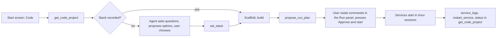

# Code Mode

> **Status: Implemented** for macOS and Linux with tmux (`crates/code`, `crates/agent/src/code_tools.rs`, `crates/app/src/state/code.rs`, `crates/app/qml/{RunPanel,WebPanel,WebFrame,DevicesPanel}.qml`, `crates/cli/src/codecmd.rs`). Not built: a runner for Windows. Verified by tests and an offscreen scripted session; the live web view, the simulators with real Xcode and Android SDK, and Linux and Windows were not run by hand `[INFERENCE]`.

## What it is

The start screen asks what the user is making. **Assets** is the editor as it always was: designs, store assets and video, and the agent starts no programs. **Code** adds a real codebase the agent builds and runs with the user. Designs and assets stay available in Code mode (same canvas, same tools, same `opendesigner/` folder), so a user building an app can make its icon, store screenshots and landing hero in the same session.

The mode is a property of the repository folder, chosen on the start screen and changeable in the Run panel.

## Flow

The stack is chosen one of two ways, both recorded the same way (`decided_by`): the user names it, or the agent asks a short list of questions (where it runs, who uses it, accounts and data, existing code, hosting, past dislikes), offers two or three options with trade-offs and a recommendation, and waits. `get_code_project` also reports what the folder already is (marker files, `package.json` scripts and frameworks), so the agent does not ask what the files answer.

## Files

| File | Where | Holds |
|------|-------|-------|
| `<repo>/.opendesigner/code.json` | the repository, trackable in git | `version`, `mode` (`assets` or `code`), `stack`, `plan` (the run plan). Written atomically; never through a symlink; at most 256 KB; unknown fields refused. |
| `code-approvals.json` | the per-user config folder (`OPENDESIGNER_CONFIG_DIR` overrides it) | repository path to the fingerprint of the plan the user approved. |

The approval is **not** in the repository on purpose: a cloned repository can ship a `code.json` with a plan, but it can never ship an approval, so opening it runs nothing.

## The run plan

`od_code::plan::RunPlan`: 1 to 8 services, each with

| Field | Rule |
|-------|------|
| `name` | `a-z`, `0-9`, `-`, up to 24 characters, unique; names the tmux session |
| `kind` | `web` (serves a page on `port`) or `process` (anything else that keeps running) |
| `command` | one line, up to 500 characters, no control characters, not starting with `-`; run as typed |
| `cwd` | relative path inside the project (default `.`); no `..`, no absolute path; symlinks are resolved and must stay inside the project when the service starts |
| `port` | required for `web`; 1024 to 65535; unique within the plan |

`RunPlan::fingerprint` is the SHA-256 of the plan's canonical JSON. An approval is valid only while the plan on disk has the same fingerprint, so changing any command, folder or port withdraws it and the user approves again.

## tmux sessions

Every service runs in its own session named `od-<folder>-<4 hex of the path hash>-<service>` on a **dedicated tmux server** (`tmux -L opendesigner`). The user's own tmux and its configuration are never touched, and `tmux -L opendesigner attach -t <session>` shows what the app started (the Run panel copies that command).

- The command runs in a login shell (`$SHELL -lc`, `/bin/sh` fallback) so `npm`, `cargo`, `flutter` and version managers are on `PATH` even when the app was started from the Dock.
- `remain-on-exit` is on: a crashed process leaves its output and exit code on screen. The status is `running`, `exited` (with the code) or `stopped`. The Run panel and `service_logs` read the last 200 and at most 500 lines (64 KB cap) with `capture-pane`.
- A web service is `ready` when its port accepts a connection on `127.0.0.1` or `::1`.
- Starting a running service is refused; restarting a dead one replaces its session.
- tmux must be installed. The error says how. Windows needs tmux inside WSL and is not supported yet.

## Agent tools

| Tool | Read-only | What it does |
|------|-----------|--------------|
| `get_code_project` | yes | Mode, stack, detected files, the questions to ask, the run plan, `approved`, the status of each service, the tmux commands to watch them |
| `set_stack` | no | Records the stack (`name`, `target`, `language`, `framework`, `notes`, `decided_by`); Code mode only |
| `propose_run_plan` | no | Saves a validated plan; never runs it; withdraws a previous approval if the plan changed; Code mode only |
| `start_services` | no | Starts one or all services of the **approved** plan |
| `stop_services` | no | Stops one or all |
| `restart_service` | no | Stop and start one |
| `service_logs` | yes | The tail of a service's screen |

`get_guidance` adds a `code_mode` note in Code mode. `get_playbook` topic `code` carries the process. There is deliberately no tool to approve a plan, change the mode, or run anything outside the plan.

## Where the logic lives

- `crates/code` (`od_code`, no Qt, no network): `plan`, `stack`, `project`, `approval`, `detect`, `tmux` (the only place a `tmux` program is started), `runner`.
- `crates/agent/src/code_tools.rs`: the MCP tools and the `Env` the app reuses.
- `crates/app/src/state/code.rs`: the user-only actions (change mode, approve and start, withdraw, per-service start/stop/restart) and the overview the Run panel polls every 1.5 s while it is visible.

## Tests

`od_code` unit tests (validation, fingerprints, approval binding and isolation, atomic writes and symlink refusal, detection) and `tests/tmux.rs`, which runs a real tmux on a private socket (skipped where tmux is absent): output and exit code of a crashing service stay readable, a running service is not started twice, stop works. `code_tools` tests: Assets mode refuses every code tool without touching tmux, nothing starts before approval and a changed plan needs a new one, a plan leaving the project is refused, a new project is told to ask before choosing a stack. App tests: the mode round-trips and nothing is open before a folder is.

## Web view

The Web panel shows a running `web` service of the approved plan in a Qt WebEngine view (Chromium, offered under the LGPLv3; `Qt::WebEngineQuick` is linked and `QtWebEngineQuick::initialize()` runs before the application object, `crates/app/cpp/web_engine.cpp`). It loads `http://localhost:<port>` only once the service is `ready`, at Phone (390), Tablet (820) or full width, with reload and an "Open in browser" button.

- The view is off the record (no cookies or cache kept), cannot open windows, and any navigation to a host other than `localhost`, `127.0.0.1` or `[::1]` is cancelled and opened in the system browser instead.
- Only `WebFrame.qml` imports QtWebEngine and it is loaded on demand, so a build or machine without it shows "Open in browser" instead of failing to start.
- It adds roughly 150 MB to the app bundle `[INFERENCE: from the framework sizes, not measured]`; the bundle is 375 MB on macOS (measured with Qt 6.12), and `scripts/bundle-licensing.sh`'s banned-module check matches no WebEngine file name (the macOS package ran with it, 2026-11-23).

## Simulators

`od_code::simulator` lists, boots, installs into, launches an app in, and takes screenshots of iOS Simulators (`xcrun simctl`, macOS with Xcode) and Android emulators (`adb`, `emulator`, found on `PATH` and in `ANDROID_HOME`, `ANDROID_SDK_ROOT`, `~/Library/Android/sdk`, `~/Android/Sdk`).

- Ids are `ios:<udid>`, `android:emulator-<port>` (running) and `android-avd:<name>` (not running). An Android serial that is not `emulator-<digits>` is refused: a phone plugged into the computer is never listed or touched.
- Programs run with fixed arguments and validated values, never through a shell, with a 20 s timeout and a 32 MB output cap. An Android virtual device keeps running, so it is started in its own tmux session (`od-<project>-emu-<name>`) and stays visible and stoppable like a service.
- Agent tools: `list_simulators` and `capture_simulator` (Code mode only; the screenshot is imported into `media/` through the same checks as a user's picture); `boot_simulator`, `install_app` (a `.app` folder or `.apk` inside the project) and `launch_app` need the user's approval of the run plan. In the Devices panel the user boots a simulator with a click, watches its screen (a screenshot about once a second while Live is on, one at a time, off the UI thread) and saves the current screen to `media/` for a store screenshot or a 3D device capture.

## Command line

`opendesigner code status | mode <assets|code> | approve [--yes] | revoke | logs <service> | simulators [DIR]`. `approve` prints every command and starts nothing without `--yes`.

## What is not built

- **Windows.** A runner that does not need tmux.
- **Selecting elements in the web view** to pin a note on or to send as context to the agent (the canvas does this for designs).
