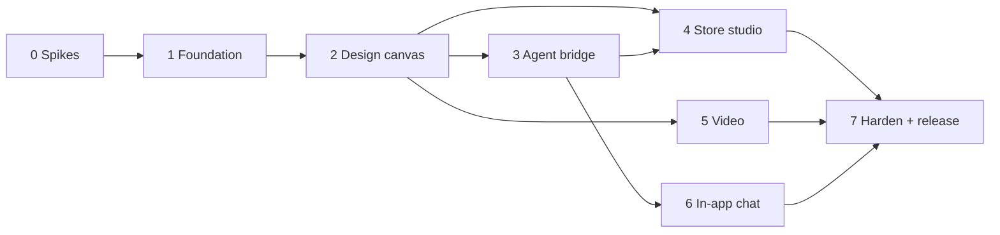

# Roadmap

> **Status: In progress.** Phases 1 to 4 and 6 are largely built (each phase below has a **Progress** note saying what is met and what is not); Phase 5 (video) and Phase 7 (release) have not started beyond a macOS bundle script. The Phase 0 spikes were not run as separate experiments: several were answered by building (the decision log says which). This page is also the decision log; every deviation from the plan is recorded here by the PR that causes it.

## Goal

A native app (macOS, Windows, Linux; Rust core under a Qt 6 C++/QML shell) where the user designs store and web assets and short videos, and guides their own coding agents by selecting, pinning notes and editing by hand, with every agent edit visible and reversible. Installing the app installs a skill and a local MCP endpoint for the agents on the machine.

## Principles

1. **Prove the risky parts first.** The canvas and video preview on Qt, the Rust–Qt bridge, and the agent bridge can each invalidate the plan. They go before any breadth.
2. **Vertical slice early.** "Open a project, drag a device frame, let Claude Code move it from a pinned note, export a validated App Store PNG" before the rest.
3. **The core stands alone.** Everything works headless before it works in a window.
4. **Operations are the product.** The UI, MCP and CLI are ways to author them.

## Overview

Phases 4 and 5 are independent after Phase 2/3 and can run in parallel.

## Phase 0: spikes

Throwaway code, results written into the wiki; exit when each question has an answer with numbers.

| Spike | Question | Exit criterion |
|-------|----------|----------------|
| Canvas on Qt | Draw 10,000 mixed nodes with pan/zoom at ≥ 60 fps on a mid-range laptop? Options: `render` output as a texture, a custom scene-graph/`QRhi` item, `QQuickPaintedItem` as a baseline ([Qt Desktop](./qt-desktop.md#canvas-rendering)) | Frame-time numbers for each on macOS; pick one |
| Text | One shaping engine for canvas and export: Qt's text stack or a Rust shaper in `render` (design-grade kerning, OpenType features, variable fonts, per-run styles) | A paragraph with runs matches a reference render on canvas and in export |
| Video surface | Play 1080p30 H.264 through Qt Multimedia (`QVideoSink`/`VideoOutput`) and through frames from our own decode; one FFmpeg in the process ([Video Editing](./video-editing.md#qt-multimedia-and-ffmpeg)) | Dropped-frame count and CPU/GPU load on macOS |
| Rust–Qt bridge | **Done 2026-11-19 on macOS:** `cxx-qt` in Cargo-only mode builds and runs a QML window backed by Rust. Windows and Linux builds are still to be run. Plain C ABI (`cbindgen`) remains the exit plan | The `app` crate; exception entry in the decision log |
| MCP loopback | `127.0.0.1` HTTP MCP server with token and Host/Origin checks, in-process with the Qt app (Rust `agent` crate); connect Claude Code and Codex CLI | Both agents list and call a test tool; a browser `fetch` is rejected |
| Skill installer | For each of Claude Code, Codex CLI, Gemini CLI, opencode, Cursor: where do user-level skills go, does it scan `~/.agents/skills/`? | Verified table replaces `[INFERENCE]` rows in [Agent Integration](./agent-integration.md#target-table) |
| File format | SVG-native versus JSON; deterministic serialization; round trip of 5,000 nodes | Pick one ([Document Format](./document-format.md#open-questions)) |
| Licensing guard | A CMake component allowlist plus a CI check that fails on any GPL-only Qt module or GPL-only dependency; QML build flow does not pull in the GPL-only Qt Qml Compiler | Check fails on a seeded violation ([Qt Desktop](./qt-desktop.md#licensing)) |

**Performance budgets** (checked by benchmarks from Phase 1; change only with a decision-log entry): canvas interaction frame time ≤ 16 ms at 10k nodes; cold start to interactive ≤ 1 s on the reference machine; operation apply + checkpoint ≤ 5 ms for a 100-op transaction; export of a 1320×2868 frame ≤ 500 ms; timeline scrub latency ≤ 100 ms. Reference machine to be named in Phase 0.

**Measured so far** (`cargo run --release -p opendesigner-render --example bench`, Apple M2 Pro, macOS, 2026-11-19; median of 7; 1320×2868 frame of rectangles, ellipses and text lines): export-scale render plus PNG encode takes 20 ms at 10 nodes, 52 ms at 1,000 and 133 ms at 10,000 (budget 500 ms: met; after parallel band rendering and a text-layout cache it was 231 ms at 10,000); a 100-operation transaction plus checkpoint takes 0.4 ms at 1,000 nodes and 4.2 ms at 10,000 (budget 5 ms: met, with little margin; node lookup is linear in the node count); the canvas path (render at about 0.3 scale plus PNG encode, before base64 and Qt's image decode) takes 9 ms at 1,000 nodes and **about 31 to 34 ms at 10,000 (budget 16 ms: still not met; it was 64 ms before parallel band rendering and the text-layout cache)**. Not measured: cold start, the Qt side of the canvas (PNG decode and texture upload), scrub latency, any other machine.

## Phase 1: foundation

Cargo workspace (`core`, `render`, `store`, `agent`, `cli`, `app`), pinned `cxx-qt`, CI (`cargo fmt`/`clippy -D warnings`/`test`, `cargo deny`, on macOS, Windows and Linux; the Qt shell on macOS), `core` node model + operations + history + project I/O with round-trip tests, an editor window with panel layout and theme, `opendesigner` CLI that opens, validates and exports a project. **Exit:** a project round-trips byte-identically; CLI exports a PNG; app opens it on all three OSes.

**Progress (2026-11-19):** all of Phase 1's code exists. The Cargo workspace (`core`, `render`, `store`, `agent`, `cli`, `app`) builds and passes `fmt`, `clippy -D warnings`, tests and `cargo deny` on macOS arm64. "Project round-trips byte-identically" and "CLI exports a PNG" are tested. The editor opens a project, draws and edits (create, move, resize, inspector, layers, undo/redo, pins, checkpoints), renders the active frame through the core, exports against store presets, serves agents over MCP and installs the skill. A scripted session of the real window runs offscreen in the tests. **Not met:** "app opens it on all three OSes" (only macOS was run), the Qt licensing guard as a CI check (the allowlist is a constant in `crates/app/build.rs`; nothing fails on a violation), and CI for the shell on any OS (the workflow is written; GitHub Actions cannot run for this account because of a billing limit).

## Phase 2: design canvas

Frames, primitives, paths with the pen tool, text, images, selection/transform/snapping, layers panel, inspector, tokens, auto layout, components and instances, undo/redo from the operation log, PNG/SVG/PDF export. **Exit:** reproduce a real GitNotēs store slide by hand; golden tests pass on all three OSes.

## Phase 3: agent bridge

`agent` crate: MCP server and tool surface, `get_guidance`, selection and annotation model and UI (pins), attributed operations with agent-change outlines and checkpoints, skill generator and installer with the verified target table, connect-command UX. **Exit:** with Claude Code and Codex CLI, a user pins "headline too small" on a text node, the agent reads the pin, resizes, resolves it; the layer is outlined; restore brings the old size back. Installer tests prove it writes only inside its directories.

**Progress (2026-11-19):** the MCP server and tools, token handling, the `serve-mcp` command, the skill generator and the previewed, reversible skill installer (`opendesigner skill …`) are built and tested (see [Agent Integration](./agent-integration.md#implemented)); annotation/selection model is in `core`. The pin UI, the agent-change outline and the first-run offer are built in the Qt shell. Not done: a Claude Code / Codex prompt turn (not signed in here).

## Phase 4: store studio

`store` crate: presets with sources and dates, device frames, panorama mode and slicing, localization overrides, capture import, `validate_export`, app icon set generator, web presets. **Exit:** regenerate GitNotēs' iPhone 6.9" set and OpenMedia's panorama in OpenDesigner and pass validation; compare to the script output programmatically for size/format (not by eye).

## Phase 5: video

**Progress (2026-11-19):** video v1 is built (design-frame clips, transitions, zoom, ffmpeg encoding, Apple app-preview rules, MCP and CLI; see [Video Editing](./video-editing.md#built-video-v1)). Footage clips with sound, overlays (titles over footage) and an editor preview tab are built too (same day). Not built: animated overlays, music and volume, speed, speech captions, timeline notes and clip selection in the window, bundled LGPL ffmpeg. **Exit** (a 30 s app preview from a screen capture with a title card, exported to the App Store spec) is built but not tried with a real screen recording.

`media` crate with the pinned FFmpeg toolchain, composition and timeline model, preview, trim/split/ripple, text and overlay clips including design frames, export presets and validation, timeline annotations and agent timeline operations. **Exit:** produce a 30 s app preview from a screen capture with a title card, exported to a validated App Store preview spec.

## Phase 6: in-app chat

**Progress (2026-11-19):** an ACP v1 client, the Chat tab (start an agent from a preset or a custom command, send, permission buttons, cancel, disconnect) and the MCP hand-off are built and tested against a scripted agent, including the window session. The session setup was also run against real Gemini CLI, the Claude adapter and the Codex adapter (see [Agent Integration](./agent-integration.md#in-app-chat)); a real prompt turn then worked end to end with omp (`omp acp`: tools called, a frame created, edit attributed to the agent), and the panel marks which agents are installed. Plans are shown (real omp emits them). Not met: a session list, a prompt turn with Claude Code, Codex or Gemini CLI (not signed in here). ACP's v2 draft is not supported. **Exit** (the Phase 3 scenario without leaving the app) is unverified.

ACP client, agent picker for installed agents, chat panel with tool calls, plans and approvals inline, guidance context attached to each prompt, scripted demo agent for tests, session list.

## Phase 7: harden and release

Accessibility and IME pass, crash-safe autosave and recovery, Qt deployment per OS with LGPL compliance (dynamic Qt, license texts, relinking path, Qt attribution), signing and notarization (macOS), installers (Windows, Linux), update channel decision, codec patent/royalty review for H.264 and similar ([Video Editing](./video-editing.md#qt-multimedia-and-ffmpeg)), docs and sample projects, a security review against [Security](./security.md), `cargo deny`. Pricing and distribution are **undecided** (see below).

## Open questions

- **Pricing and distribution.** GitNotēs and OpenMedia have paid tiers through stores; a desktop editor's model (free and open, paid cloud-free Pro, store distribution) is not decided. Whatever is chosen must keep open files and local-first ([AGENTS.md invariants 1, 8](../../AGENTS.md)).
- **One rasterizer or two.** Share `render` between export and the canvas, or let the canvas use a scene-graph/`QRhi` item and test equivalence. Phase 0 canvas spike.
- **Docking and component kit.** QML `SplitView` and our own panel manager, since KDDockWidgets is GPL-only ([Qt Desktop](./qt-desktop.md#licensing)); scope of a custom Qt Quick Controls style. Phase 0.
- **Plugins and scripting.** OpenCut plans both; we defer. Not before the operation API is stable.
- **Code-driven motion.** Kino uses Remotion. If we ever need it, it must be sandboxed and approved per project (invariant 3).
- **Collaboration.** Git-based sharing only for now.
- **Penpot/Figma import.** Only if requested.

## Decision log

| Date | Decision | Why |
|------|----------|-----|
| 2026-11-19 | Build a native GUI for agent-guided asset creation instead of continuing to script store art through a CLI agent | Text-only guidance is the bottleneck ([Architecture](./architecture.md#the-problem-this-solves)) |
| 2026-11-19 | UI toolkit: **Qt 6 (C++/QML)**, over GPUI (first choice, dropped the same day) | The canvas and video preview are custom rendering under any toolkit; Qt supplies the surrounding problems (text input/IME, accessibility, native dialogs and menus, high-DPI, playback, packaging) that GPUI leaves to us, and GPUI is pre-1.0 with a young widget set. Costs: two languages, LGPL obligations, heavier distribution ([Qt Desktop](./qt-desktop.md#why-qt)) |
| 2026-11-19 | Core crates never import Qt; the Qt app, MCP server and CLI share operations; C++/QML hold presentation only | OpenCut's principle; headless and testable; keeps the toolkit replaceable |
| 2026-11-19 | Integrate agents through an Agent Skill plus a local MCP server, installed by the app | Skills carry taste, MCP carries capability; Kino, Penpot and Figma validate MCP; `.agents/skills/` is the cross-client convention |
| 2026-11-19 | Agent edits are attributed operations with checkpoints, outlined in the UI | Kino's model; makes agent output reviewable and reversible |
| 2026-11-19 | Documents are data, not code | Security and agent legibility ([invariant 3](../../AGENTS.md)); differs from Kino/Remotion |
| 2026-11-19 | Keep MPL-2.0 (already in the repository) | Matches GitNotēs and OpenMedia; Qt is used under LGPLv3 (dynamic linking), which is compatible; OpenCut (MIT) is a compatible input |
| 2026-11-19 | Documentation system copied from GitNotēs/OpenMedia: wiki-first `AGENTS.md`, `CHANGELOG.md`, `docs/wiki/` synced to the GitHub Wiki, worktrees | Proven in both projects |
| 2026-11-19 | Logo is `assets/logo.svg`; brand ramp taken from it | Maintainer's choice |
| 2026-11-19 | The quality bar goes out with the MCP `initialize` instructions and the chat's first prompt, and the playbooks are a tool (`get_playbook`), not only skill files | A skill only works where it is installed and the agent chooses to load it; the user's complaint was that agent output was mediocre by default. The bar is 2 KB; the playbooks load on demand |
| 2026-11-19 | A format the user chose is enforced for videos and changes only through a request they answer in the window; images are guidance only | The user wanted agents to choose when nothing is chosen and to ask before changing what was. Refusing a frame size would break panoramas (several slides wide) |
| 2026-11-19 | Qt stays LGPL: allowlisted modules only, no GPL-only Qt modules or GPL-only libraries (KDDockWidgets, Qt Canvas Painter, …) | MPL-2.0 project; GPL-only code would force GPL ([invariant 12](../../AGENTS.md), [Qt Desktop](./qt-desktop.md#licensing)) |
| 2026-11-19 | Dependency policy: only popular, well-maintained packages; exceptions are logged here ([AGENTS.md](../../AGENTS.md#dependencies)) | Smaller audit surface, less abandonment risk |
| 2026-11-19 | **Exception:** `cxx-qt` (KDAB) as the Rust–Qt bridge, pending the Phase 0 bridge spike | Evidence read 2026-11-19: KDAB-maintained, MIT or Apache-2.0, release 0.10.0 on 2026-08-24, but pre-1.0 and modest adoption (about 211k total downloads, 7 dependents on crates.io), so it is below the "popular" bar. Alternatives: plain C ABI with `cbindgen`, which is the exit plan if `cxx-qt` is abandoned or the spike fails |
| 2026-11-19 | Phase 1 core uses sRGB hex colors, typed `set` properties, document-minted ids and an in-memory undo stack; text and image nodes exist in the model but are reported as warnings by `render` | Smallest design that satisfies the Phase 1 exit; each is listed with its migration path in [Document Format](./document-format.md#implemented-cratescore) |
| 2026-11-19 | Store presets ship with `Verification::CopiedFromReference`; the CLI prints a note until a preset is read against its primary source | The rules came from GitNotēs' notes, not from Apple/Google pages; invariant 9 requires saying so |
| 2026-11-19 | Dependencies for the MCP server: `axum` 0.8 and `tokio` 1 (HTTP), `base64` 0.23 (image content), `getrandom` 0.4 (token). Rejected: `tiny_http` (last release 2022-10), `subtle` (last release 2024-06) | crates.io on 2026-11-19: axum 605M downloads, updated 2026-04-14; tokio 1.2B, updated 2026-10-21; base64 2.0B, updated 2026-08-04; getrandom 2.7B, updated 2026-06-17. The constant-time comparison is 8 lines and written in-house |
| 2026-11-19 | Skill targets reduced to two rows after verification: `~/.agents/skills` (Codex, Gemini CLI, opencode) and `~/.claude/skills` (Claude Code); Cursor is not supported | Each agent's own docs were read; Cursor's were not verified. `sha2` 0.11 added for install hashes (1.26B downloads, updated 2026-10-12) |
| 2026-11-19 | The Qt shell is built with Cargo and `cxx-qt`'s `qml_module`, with no CMake and no C++ sources; the `bridge` crate and the C++ canvas item are dropped for now | `cxx-qt-build` generates and compiles the glue, so one build tool drives everything, tests link, and there is one fewer language. A C++ `QQuickItem` stays an option if the canvas spike needs it. Edition-2024 `unsafe_code = "forbid"` is relaxed for the `app` crate only, because the macros expand to FFI code |
| 2026-11-19 | The canvas is a PNG rendered by `render` and shown by a QML `Image` | Smallest design that shows the real export output (so canvas and export cannot differ) and works on every platform. Cost: every document change re-renders the frame on the UI thread, so it will not meet the 16 ms budget at 10k nodes; the Phase 0 canvas spike (texture or scene-graph item) is still open |
| 2026-11-19 | Dependencies for the shell: `cxx` 1, `cxx-qt` and `cxx-qt-lib` 0.10.0 (exact pins; exception above) | cxx is dtolnay's widely used FFI crate (MIT or Apache-2.0). `cxx-qt-lib` is part of the same KDAB project as `cxx-qt` |
| 2026-11-19 | Text is shaped by `cosmic-text` 0.19 and drawn by `render`; the bundled default is Lato Regular and Bold (SIL OFL); other families come from the machine's fonts. This resolves the Phase 0 text spike for export: one shaping engine in `render`, and the canvas shows `render`'s output, so they cannot differ | cosmic-text: 12.7M downloads, updated 2026-04-22, System76 (COSMIC desktop); it brings HarfBuzz-compatible shaping (`harfrust`), bidi, line breaking, `swash` rasterization and `fontdb`. Considered: `ab_glyph`/`fontdue` (rasterize only, no shaping, so no kerning/ligatures/complex scripts), `rustybuzz` + `ttf-parser` by hand (re-implements cosmic-text's layout). Lato because it is OFL, static (variable fonts are not reliably weight-selectable through fontdb) and neutral; its two files add 1.3 MB |
| 2026-11-19 | **Exception:** `cargo deny` ignores RUSTSEC-2026-0192 (`ttf-parser` unmaintained, no vulnerability), reached only through `fontdb` | Font bytes come from the app bundle and the user's installed fonts, never from a project file or an agent (those name a family only), so a parser bug is not reachable by untrusted input in the way an image decoder is. Exit: take the `fontdb` release that moves to `skrifa`/`fontations` when `cosmic-text` adopts it; revisit at each `cosmic-text` bump |
| 2026-11-19 | Images are decoded by the `image` crate 0.25 with only the `png`, `jpeg` and `webp` features; agents cannot import files, only the user can (file dialog or drop), and `core` accepts only `media/<plain name>` references | `image`: 257M downloads, updated 2026-03-10, image-rs organization. It adds `zune-jpeg`, `image-webp`, `moxcms`, all permissive. Considered: `png` alone (already a dependency, but no JPEG or WebP; screenshots and photos arrive in all three). An agent `import_media(path)` was in the original design and is dropped: it would read a path from the user's disk, which invariant 5 forbids |
| 2026-11-19 | Device frames are generated from ordinary nodes (body, screen, camera) as neutral outlines, not shipped as manufacturer artwork; exports of sets and panoramas are validated entirely before anything is written | Device bezels are trademarked/copyrighted artwork whose redistribution terms were not verified; a generated outline needs no license, stays editable and goes through the same operations, history and agent attribution. Real artwork can be added later as user-supplied images dropped on the screen slot. All-or-nothing writes mean a store set never ends half-exported |
| 2026-11-19 | Tokens change through a `set_token` operation in the normal history rather than a separate side channel | A second path would need its own attribution, undo and checkpoint handling; as an operation it inherits all of them (invariant 4). Removal is refused while used so a document never holds a paint it cannot resolve |
| 2026-11-19 | Video is encoded by running the `ffmpeg` program as a separate process, fed raw frames over a pipe, not by linking FFmpeg libraries; the app ships and links no GPL code. **Deviation from invariant 10's in-process wording** (invariant 10 is reworded to match) | The editor already draws every frame itself, so v1 needs only an encoder. A child process keeps FFmpeg's license outside ours whatever build the user has, needs no C bindings (`ffmpeg-next` and friends are single-maintainer and track FFmpeg majors), and works with the OS encoders (VideoToolbox, Media Foundation) that carry no patent question for us. Cost: no in-process decode for scrubbing yet, an `ffmpeg` must exist (the app will bundle a pinned LGPL build, not done), and Qt Multimedia's FFmpeg major is not matched because nothing is loaded into the process. Considered: `openh264` crate (BSD, but compiles Cisco's source, so the patent license is ours to carry), pure-Rust AV1 (not accepted by the stores), linking FFmpeg via bindings |
| 2026-11-19 | A video v1 clip shows a design frame; time is integer milliseconds; transitions overlap the previous clip | App previews are made of the same frames as the store screenshots, so one design serves both, and the agent edits video with the operations it already uses. Milliseconds are exact enough at 1-60 fps (frame times are floored, never accumulated). Overlap (not extra time) matches how editors and agents think of "a 0.5 s crossfade". Footage clips, tracks and overlays are the next step and extend `Clip` |
| 2026-11-19 | Agents may find pictures and videos anywhere under the user's home folder and copy them into the project (`find_files`, `import_file`); on by default with an off switch. **Deviation from invariant 5** (reworded) | The user asked for it after the agent said it could only use what had been added to memory. Kept narrow: read-only, image and video types only, content-checked, copy into `media/`, never returns contents. Risks are in security.md. Considered: a per-file approval prompt (blocks the agent mid-turn), folder allow-lists (more setup than the user wants) |
| 2026-11-19 | A video export runs on a copy of the project, not under the workspace lock, and reports progress as a job the window shows with a Stop button | The export held the lock for the whole video, so the window froze (it reads the same state). Copying the document costs milliseconds; edits made during an export are not in that export |
| 2026-11-19 | The 16 ms canvas budget is **not met at 10,000 nodes** by the render-to-PNG canvas (64 ms measured, then about 31 to 34 ms after frames of 256 or more nodes were drawn in parallel horizontal bands, nodes outside a band skipped, and laid-out text cached); it is met at 1,000 nodes (9 ms). Pan and zoom do not re-render (QML moves the picture), so this is the cost of redrawing after a change. Budget not changed | Rendering the whole frame on every change is the design recorded above. Still not built: render only the changed region, keep a retained scene and a GPU path (the Phase 0 canvas spike), or lower the preview scale while a gesture is in progress. The budget stays as written until one of those lands |
| 2026-11-19 | Translations are per-language overrides of text nodes' `text`, stored in the manifest and changed by a `set_localized_text` operation; adding a language copies the current text | One design exports every language without re-prompting an agent. As operations they inherit attribution, undo and checkpoints (invariant 4); keyed by node id so a translation follows its node through moves and reparenting. Considered: duplicating frames per language (diverges as soon as the design changes) and a separate translations file (a second path outside the history). Limits: only text is per-language. A translation that wraps to more rows than its box is tall is reported like any other overflow (`od_render::check_text`) |
| 2026-11-19 | The in-app chat speaks ACP v1 as a client of the user's own agent, hands it the editor's MCP server over HTTP, serves no file or terminal capability, and starts only a user-typed command with no shell | The editor's tools already exist as MCP; ACP is how a GUI starts an agent and shows its turns, so the chat adds no second edit path (invariants 3, 4 and 7 hold unchanged). Declaring no capabilities is safe because agents do their own file work and ask for permission themselves. Considered: a direct model API (needs keys, invariant 7) and embedding an agent. Risk: ACP and the adapters are changing fast; the client is small (one module) so it can follow |
