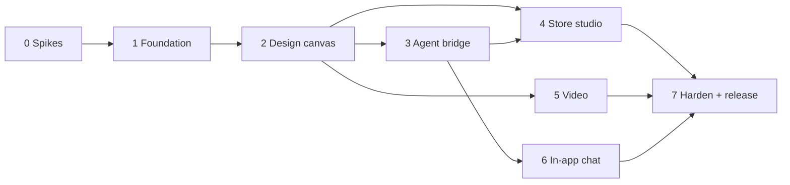

# Roadmap

> **Status: In progress.** Phases 1 to 4 and 6 are largely built (each phase below has a **Progress** note saying what is met and what is not); Phase 5 (video) and Phase 7 (release) have not started beyond a macOS bundle script. The Phase 0 spikes were not run as separate experiments: several were answered by building (the decision log says which). This page is also the decision log; every deviation from the plan is recorded here by the PR that causes it.

## Goal

A native app (macOS, Windows, Linux; Rust core under a Qt 6 C++/QML shell) where the user designs store and web assets and short videos, and guides their own coding agents by selecting, pinning notes and editing by hand, with every agent edit visible and reversible. Installing the app installs a skill and a local MCP endpoint for the agents on the machine.

## Principles

1. **Prove the risky parts first.** The canvas and video preview on Qt, the Rust–Qt bridge, and the agent bridge can each invalidate the plan. They go before any breadth.
2. **Vertical slice early.** "Open a project, drag a device frame, let Claude Code move it from a pinned note, export a validated App Store PNG" before the rest.
3. **The core stands alone.** Everything works headless before it works in a window.
4. **Operations are the product.** The UI, MCP and CLI are ways to author them.

## Overview

Phases 4 and 5 are independent after Phase 2/3 and can run in parallel.

## Phase 0: spikes

Throwaway code, results written into the wiki; exit when each question has an answer with numbers.

| Spike | Question | Exit criterion |
|-------|----------|----------------|
| Canvas on Qt | Draw 10,000 mixed nodes with pan/zoom at ≥ 60 fps on a mid-range laptop? Options: `render` output as a texture, a custom scene-graph/`QRhi` item, `QQuickPaintedItem` as a baseline ([Qt Desktop](./qt-desktop.md#canvas-rendering)) | Frame-time numbers for each on macOS; pick one |
| Text | One shaping engine for canvas and export: Qt's text stack or a Rust shaper in `render` (design-grade kerning, OpenType features, variable fonts, per-run styles) | A paragraph with runs matches a reference render on canvas and in export |
| Video surface | Play 1080p30 H.264 through Qt Multimedia (`QVideoSink`/`VideoOutput`) and through frames from our own decode; one FFmpeg in the process ([Video Editing](./video-editing.md#qt-multimedia-and-ffmpeg)) | Dropped-frame count and CPU/GPU load on macOS |
| Rust–Qt bridge | **Done 2026-11-19 on macOS:** `cxx-qt` in Cargo-only mode builds and runs a QML window backed by Rust. Windows and Linux builds are still to be run. Plain C ABI (`cbindgen`) remains the exit plan | The `app` crate; exception entry in the decision log |
| MCP loopback | `127.0.0.1` HTTP MCP server with token and Host/Origin checks, in-process with the Qt app (Rust `agent` crate); connect Claude Code and Codex CLI | Both agents list and call a test tool; a browser `fetch` is rejected |
| Skill installer | For each of Claude Code, Codex CLI, Gemini CLI, opencode, Cursor: where do user-level skills go, does it scan `~/.agents/skills/`? | Verified table replaces `[INFERENCE]` rows in [Agent Integration](./agent-integration.md#target-table) |
| File format | SVG-native versus JSON; deterministic serialization; round trip of 5,000 nodes | Pick one ([Document Format](./document-format.md#open-questions)) |
| Licensing guard | A CMake component allowlist plus a CI check that fails on any GPL-only Qt module or GPL-only dependency; QML build flow does not pull in the GPL-only Qt Qml Compiler | Check fails on a seeded violation ([Qt Desktop](./qt-desktop.md#licensing)) |

**Performance budgets** (checked by benchmarks from Phase 1; change only with a decision-log entry): canvas interaction frame time ≤ 16 ms at 10k nodes; cold start to interactive ≤ 1 s on the reference machine; operation apply + checkpoint ≤ 5 ms for a 100-op transaction; export of a 1320×2868 frame ≤ 500 ms; timeline scrub latency ≤ 100 ms. Reference machine to be named in Phase 0.

**Measured so far** (`cargo run --release -p opendesigner-render --example bench`, Apple M2 Pro, macOS, 2026-11-19; median of 7; 1320×2868 frame of rectangles, ellipses and text lines): export-scale render plus PNG encode takes 20 ms at 10 nodes, 52 ms at 1,000 and 133 ms at 10,000 (budget 500 ms: met; after parallel band rendering and a text-layout cache it was 231 ms at 10,000); a 100-operation transaction plus checkpoint takes 0.4 ms at 1,000 nodes and 4.2 ms at 10,000 (budget 5 ms: met, with little margin; node lookup is linear in the node count); the canvas path (render at about 0.3 scale plus PNG encode, before base64 and Qt's image decode) takes 9 ms at 1,000 nodes and **about 31 to 34 ms at 10,000 (budget 16 ms: still not met; it was 64 ms before parallel band rendering and the text-layout cache)**. Not measured: cold start, the Qt side of the canvas (PNG decode and texture upload), scrub latency, any other machine.

## Phase 1: foundation

Cargo workspace (`core`, `render`, `store`, `agent`, `cli`, `app`), pinned `cxx-qt`, CI (`cargo fmt`/`clippy -D warnings`/`test`, `cargo deny`, on macOS, Windows and Linux; the Qt shell on macOS), `core` node model + operations + history + project I/O with round-trip tests, an editor window with panel layout and theme, `opendesigner` CLI that opens, validates and exports a project. **Exit:** a project round-trips byte-identically; CLI exports a PNG; app opens it on all three OSes.

**Progress (2026-11-19):** all of Phase 1's code exists. The Cargo workspace (`core`, `render`, `store`, `agent`, `cli`, `app`) builds and passes `fmt`, `clippy -D warnings`, tests and `cargo deny` on macOS arm64. "Project round-trips byte-identically" and "CLI exports a PNG" are tested. The editor opens a project, draws and edits (create, move, resize, inspector, layers, undo/redo, pins, checkpoints), renders the active frame through the core, exports against store presets, serves agents over MCP and installs the skill. A scripted session of the real window runs offscreen in the tests. **Not met:** "app opens it on all three OSes" (only macOS was run), the Qt licensing guard as a CI check (the allowlist is a constant in `crates/app/build.rs`; nothing fails on a violation), and CI for the shell on any OS (the workflow is written; GitHub Actions cannot run for this account because of a billing limit).

## Phase 2: design canvas

Frames, primitives, paths with the pen tool, text, images, selection/transform/snapping, layers panel, inspector, tokens, auto layout, components and instances, undo/redo from the operation log, PNG/SVG/PDF export. **Exit:** reproduce a real GitNotēs store slide by hand; golden tests pass on all three OSes.

## Phase 3: agent bridge

`agent` crate: MCP server and tool surface, `get_guidance`, selection and annotation model and UI (pins), attributed operations with agent-change outlines and checkpoints, skill generator and installer with the verified target table, connect-command UX. **Exit:** with Claude Code and Codex CLI, a user pins "headline too small" on a text node, the agent reads the pin, resizes, resolves it; the layer is outlined; restore brings the old size back. Installer tests prove it writes only inside its directories.

**Progress (2026-11-19):** the MCP server and tools, token handling, the `serve-mcp` command, the skill generator and the previewed, reversible skill installer (`opendesigner skill …`) are built and tested (see [Agent Integration](./agent-integration.md#implemented)); annotation/selection model is in `core`. The pin UI, the agent-change outline and the first-run offer are built in the Qt shell. Not done: a Claude Code / Codex prompt turn (not signed in here).

## Phase 4: store studio

`store` crate: presets with sources and dates, device frames, panorama mode and slicing, localization overrides, capture import, `validate_export`, app icon set generator, web presets. **Exit:** regenerate GitNotēs' iPhone 6.9" set and OpenMedia's panorama in OpenDesigner and pass validation; compare to the script output programmatically for size/format (not by eye).

## Phase 5: video

**Progress (2026-11-19):** video v1 is built (design-frame clips, transitions, zoom, ffmpeg encoding, Apple app-preview rules, MCP and CLI; see [Video Editing](./video-editing.md#built-video-v1)). Footage clips with sound, overlays (titles over footage) and an editor preview tab are built too (same day). **Progress (2026-11-20):** keyframes of any number of a node over the video's time, named moves, motion blur and **3D devices** (a phone, tablet, laptop or monitor in perspective with a capture or a recording on its screen) are built; the agent writes them with `animate_preset` and `apply_ops animate`, and the CLI has `animate`. Not built: animated overlays, music and volume, speed, speech captions, timeline notes and clip selection in the window, bundled LGPL ffmpeg. **Exit** (a 30 s app preview from a screen capture with a title card, exported to the App Store spec) is built but not tried with a real screen recording.

`media` crate with the pinned FFmpeg toolchain, composition and timeline model, preview, trim/split/ripple, text and overlay clips including design frames, export presets and validation, timeline annotations and agent timeline operations. **Exit:** produce a 30 s app preview from a screen capture with a title card, exported to a validated App Store preview spec.

## Phase 6: in-app chat

**Progress (2026-11-19):** an ACP v1 client, the Chat tab (start an agent from a preset or a custom command, send, permission buttons, cancel, disconnect) and the MCP hand-off are built and tested against a scripted agent, including the window session. The session setup was also run against real Gemini CLI, the Claude adapter and the Codex adapter (see [Agent Integration](./agent-integration.md#in-app-chat)); a real prompt turn then worked end to end with omp (`omp acp`: tools called, a frame created, edit attributed to the agent), and the panel marks which agents are installed. Plans are shown (real omp emits them). Not met: a session list, a prompt turn with Claude Code, Codex or Gemini CLI (not signed in here). ACP's v2 draft is not supported. **Exit** (the Phase 3 scenario without leaving the app) is unverified.

ACP client, agent picker for installed agents, chat panel with tool calls, plans and approvals inline, guidance context attached to each prompt, scripted demo agent for tests, session list.

## Phase 7: harden and release

Accessibility and IME pass, crash-safe autosave and recovery, Qt deployment per OS with LGPL compliance (dynamic Qt, license texts, relinking path, Qt attribution), signing and notarization (macOS), installers (Windows, Linux), update channel decision, codec patent/royalty review for H.264 and similar ([Video Editing](./video-editing.md#qt-multimedia-and-ffmpeg)), docs and sample projects, a security review against [Security](./security.md), `cargo deny`. Pricing and distribution are **undecided** (see below).

## Open questions

- **Pricing and distribution.** GitNotēs and OpenMedia have paid tiers through stores; a desktop editor's model (free and open, paid cloud-free Pro, store distribution) is not decided. Whatever is chosen must keep open files and local-first ([AGENTS.md invariants 1, 8](../../AGENTS.md)).
- **One rasterizer or two.** Share `render` between export and the canvas, or let the canvas use a scene-graph/`QRhi` item and test equivalence. Phase 0 canvas spike.
- **Docking and component kit.** QML `SplitView` and our own panel manager, since KDDockWidgets is GPL-only ([Qt Desktop](./qt-desktop.md#licensing)); scope of a custom Qt Quick Controls style. Phase 0.
- **Plugins and scripting.** Deferred. Not before the operation API is stable.
- **Code-driven motion.** If we ever need it, it must be sandboxed and approved per project (invariant 3).
- **Collaboration.** Git-based sharing only for now.
- **Penpot/Figma import.** Only if requested.

## Decision log

| Date | Decision | Why |
|------|----------|-----|
| 2026-11-21 | A block expands into ordinary nodes and ordinary `animate` keys, applied as one transaction through the existing `apply_ops` path; no new `Operation` variant and no core model change. | Invariant 4 (every edit attributed, checkpointed, reversible) and the brief's "no new `Operation` variant, no bypass of history". — A `Operation::AddBlock` (a core format change plus a version bump and a migration); a `block` node kind (the renderer and the editor would have to understand it). — The document format cannot tell a block from hand-built nodes; the name prefix `block:<id>#<n>` is the only trace, so finding and removing a block together depends on that convention. |
| 2026-11-21 | The palette comes from the document's tokens; a block that finds none creates `block.background`, `block.foreground`, `block.accent` and `block.muted` once (as `set_token` operations in the same transaction). | `review_frame` flags hard-coded colors, and one `set_token` should recolor every block. — Hard-coded hex per block (flagged by the reviewer); a fixed token set only (a block would fight a brand's own names). — Up to four extra tokens per project; the tokens survive an undo of the block that created them (they are ordinary token operations). |
| 2026-11-21 | Text is measured with the renderer's own layout (`od_render::measure_text`, a small public function added to the render crate) and shrunk until it fits; a block that cannot fit refuses with a reason. | No overflow, ever, and the agent is told to shorten the copy instead of shipping a broken slide. — A fixed type scale (long copy overflows); letting the renderer clip (silent loss). — One public function in `crates/render`; fitting costs a few measurements per text node at plan time. |
| 2026-11-21 | Lines and rings are chains of small ellipses (a dot every 0.45 of the stroke width); a block never uses more than one font family. | The document has no path node, and adding one would change the core model, the renderer and the file format. — An SVG picture per chart (not editable, colors baked in); a polyline node (a core change). — Many nodes (a 24-point line is a few hundred dots), round dot ends, and the dots count as "text layers" only for the reviewer. |
| 2026-11-21 | Pictures a block needs are written to the project's `media/` folder, the file name being the hash of the recipe (so the same block asks for the same file and the plan stays pure). | `media/` is the only place the renderer reads images from; the recipe hash makes the plan side-effect free and the file reusable. — No pictures (no backdrops, no icons); a separate assets folder (the renderer would have to change). — A block with pictures needs a project folder (the call says so); the files stay on disk after an undo. |
| 2026-11-21 | The block's group is named `block:<id>#<n>` and its parts `block:<id>#<n>/<part>`. | The name string is the only handle the model has; a group holds the block's parts so deleting it removes the whole block in one step. — An annotation or a token (not a container); a typed id convention (ids are minted by the document and never reusable). — The convention is a convention, not a typed fact; a second block of the same kind gets the next number. |
| 2026-11-21 | The CLI reads a block's own parameters from a JSON file (`--params`), the MCP tool takes them inline. | The command line cannot carry arbitrary JSON inline; the agent path can. — One flag per parameter (dozens of flags); `key=value` pairs (untyped). — One extra file for a parameterized block on the command line. |
| 2026-11-21 | `stagger_in` makes no nodes and only keyframes nodes that already exist, and needs a video. | It is a motion wrapper over selected nodes; it is the only block whose plan is purely `animate` operations. — Creating copies of the nodes (duplicates the design the user made). — It fails without a video or without node ids, and it does not undo the nodes it animated. |
| 2026-11-21 | The catalog holds 31 blocks, not the ~450 of the reference tool. | The brief asked for a smaller, high-quality set (28 target). — A larger catalog (unreviewed blocks, more to maintain). — Fewer ready-made options; each one is tested at three sizes. |
| 2026-11-21 | `Video.tracks` (a new optional list) beside the older `Video.audio`; the older one is read as track #0 (`Video::sound_tracks()`) | Old projects load and save byte-identically (both fields are skipped while empty); the older tool (`set_video audio`) keeps working — A migration that rewrites `audio` into `tracks` (breaks byte-identical round trips of old fixtures); replacing `audio` outright (breaks old projects) — Two ways to say "one sound track"; the export and the mixer read `sound_tracks()` |
| 2026-11-21 | Tracks and captions change as **whole values** through `set_video` (`VideoProperty::Tracks`, `VideoProperty::Captions`), not as new operation variants | The operation enum, the history and the undo path stay untouched; the inverse of a whole-list replace is the old list. The tools compute the new list with `tracks_with_added/changed/removed` and `captions_with_cue/...` and validate it — Granular `add_track`/`add_cue` operation variants (each a new enum variant in `ops.rs`, a new inverse, more merge conflict with other slices) — The history stores the list twice per step (bounded by the caps: 8 tracks, 2000 cues) |
| 2026-11-21 | Ducking with ffmpeg's `sidechaincompress` (voice pieces summed, `asplit` into one side-chain per ducked music piece, `apad`ded) | One pass, no analysis step, sample-exact; the graph is a pure function of the pieces, so it is unit-tested without ffmpeg — A volume envelope computed in Rust from the voice's RMS (needs a decode pass, two passes over the audio, and an envelope that lags) — The threshold (0.03, about -30 dBFS) and the ratio mapping (depth 0..1 -> 1:1..20:1) are fixed numbers, verified by measurement, not by ear |
| 2026-11-21 | The side-chain is padded with silence (`apad`) | Without it the compressor ends the music where the voice ends (the mix came out 4 s instead of 6 s in the first test run) — Shortening the voice bus to the music (wrong: the voice may be longer) — The padded side-chain is infinite; ffmpeg stops when the main input ends |
| 2026-11-21 | The mix ends with `amix` + `apad`, and the export keeps `-shortest` | A sound shorter than the video must not cut the video short (the export came out 3 s instead of 4 s) — Leaving the mix unpadded and dropping `-shortest` (the video would then be as long as the longest sound) — The exported file carries silence to the end of the picture |
| 2026-11-21 | Every track and cue is normalized to 48 kHz stereo in the filter graph (`aresample`, `aformat`) | The side-chain compressor, `amix` and `pan` need one format to work on — Letting ffmpeg negotiate the formats (the filter graph would depend on the input files) — Mono sources become stereo (a slight change to how they sound) |
| 2026-11-21 | Captions live in `Video.captions` (`crates/core/src/captions.rs`) as data, never script | Invariant 3: documents are data. The renderer shapes the text with cosmic-text, like every other text — An effect or a script per cue (would break the invariant and the file format) — Word timings are data the agent supplies; no speech recognition |
| 2026-11-21 | The document keeps only the **shape** rules of captions (caps, order, no overlap, word spelling); the **tools** additionally require every cue to end inside the video (`captions::check_within`) | Shortening a video must not make the document invalid, or an undo could not restore captions (the history would refuse the inverse) — Strict bounds in the document too (an undo after a clip was shortened would fail) — A cue past the end of a shortened video stays in the file and is simply not drawn |
| 2026-11-21 | `captions_from_script` spreads a script over a time range **by word length**, and every text that says so calls it an estimate | The user asked for a proportional spread, and there is no speech recognition to do better — Refusing to spread a script at all; guessing timings from a reading-speed constant (the same thing, less honestly named) — The timings are rough; the tool and the docs say so |
| 2026-11-21 | Speech-to-text is **not** built; the transcript comes from the user's own speech MCP server | Recognizing speech needs a model or a network service, which breaks local-first (invariant 1) and adds a heavy dependency — Whisper.cpp or a cloud API (a new dependency and a new network destination) — An agent without a speech server can only use scripts and manual cues |
| 2026-11-21 | Pause detection and waveforms are ffmpeg calls in `od_media` (`analysis.rs`), never a decoder crate | No new dependency; ffmpeg is already the tool that reads media, and it runs as a separate process — A Rust decoder crate (a new dependency, and a second decoder to keep in step) — The tools need ffmpeg on the machine; they say so when it is missing |
| 2026-11-21 | Cutting the pauses out of a clip uses the **existing** clip operations (`set_clip` + `add_clip`), planned in `od_core::pauses.rs` | No new operation, one undoable transaction, the clip stays a clip — New `split_clip`/`ripple_delete` operations (new enum variants, new inverses, and a ripple that shifts every later clip) — Overlays, captions and tracks keep their absolute times and do **not** move; the tool says so |
| 2026-11-21 | The cut keeps `keep_ms` of each pause at both ends and drops pieces under 100 ms | Speech is not clipped and the clip stays long enough to be a clip — Cutting the pause exactly (clips the first and last syllable) — A little silence stays |
| 2026-11-21 | Waveforms are computed by the app (`crates/app/src/sound_rows.rs`), cached per file until it changes, and published in `video.sound_rows` | The timeline needs the peaks; computing them in the agent crate would mean a tool call for every frame — Computing them in QML (QML would have to decode audio, which it cannot) — The first snapshot with a new file decodes it once (a second or two for a long file) |
| 2026-11-21 | The app reaches ffmpeg through `od_agent::audio_tools::waveform_of` instead of depending on `od_media` | The app crate's dependency list stays as it was (no new crate in `crates/app/Cargo.toml`, one less thing to merge) — Adding `opendesigner-media` to the app crate — The app cannot probe a file by itself |
| 2026-11-21 | The store rules (`od_store::video`) were **not** extended | The only rule source recorded for audio is "the audio track is not checked" (Apple's page says nothing about a track's content), so there is no rule to check — Inventing a rule (would claim a store rule that was never read) — Nothing; the not-checked line still says the audio track is not checked |
| 2026-11-21 | The Whisper-style word-timing field names (`text`/`word`, `start`/`end` in seconds) are accepted as well as `start_ms`/`end_ms` | Speech servers differ; accepting both avoids a conversion step the agent cannot do — Only one spelling (the agent would have to convert) — Documented as `[INFERENCE]` in the wiki |
| 2026-11-21 | Keep milliseconds as the stored unit and snap to the frame grid when an operation is applied | No format change; old projects load unchanged; the grid is exact integer math, so nothing drifts — Store ticks or frames (a format change and a migration); keep floating-point seconds (drift) — The snapped value can differ from what was asked for; the operation result says so |
| 2026-11-21 | The recorded operation carries the snapped value | The agent, the history and `list_videos` all show the number that was kept — Snapping at render time only (the agent would never learn the real value) — None |
| 2026-11-21 | Operations the history issues (undo, redo, restore) are never snapped | Undoing must put back exactly the numbers a loaded project had — Snapping them too (an old project's 1001 ms would become 1000 on undo) — Two code paths for the same operation |
| 2026-11-21 | A value outside its allowed range is left alone rather than clamped | The operation's own check then refuses it with the rule it broke ("a transition lasts 1 to 5000 ms"), instead of a silent clamp — Clamp into range (a wrong value is accepted quietly) — None |
| 2026-11-21 | The renderer asks for frame `n` at `round(n * 1000 / fps)`, not `floor` | A clip that starts on the grid shows its first picture on exactly the frame that starts there; flooring would show the previous clip's last picture for one frame at 24 fps — Floor (the frame's start time, but a clip appears one frame late) — The picture of a frame is the frame nearest its index, not the one starting at it |
| 2026-11-21 | `duration_ms` is the clip's length **on the timeline**; the source span is `duration_ms * speed` | One number to set; the timeline and the file stay in step — A separate "source out" field (two lengths to keep in step) — The agent must remember that a 2x clip reads twice as much of the file |
| 2026-11-21 | A ramp **replaces** the constant speed (a clip has one or the other) | A ramp is a curve; multiplying it by a constant is a second way to say the same thing — Both together (the rate is the product; more ways to be wrong) — The agent sets `speed` back to 1 before a ramp |
| 2026-11-21 | The ramp's source time is the integral of the rate, computed a millisecond at a time (midpoint rule) | The same clip reads the same moment of the file on every machine; a closed form would drift at the frame edges — A closed form (faster, but the mapping of a frame depends on rounding) — A table of one float per millisecond of clip (up to 60 000 entries) |
| 2026-11-21 | A grade is stored as plain numbers; a named look is expanded when the grade is read | What is stored, undone and keyframed is always numbers; a look is only a shorthand — Storing the look name (the file says "warm" and nobody can tell what that means; a look could not be edited) — A look's numbers are frozen in the file once it is set |
| 2026-11-21 | The colour maths runs on the stored (gamma-encoded) values, not in linear light | It is what most editors' basic controls do, and it is what the numbers mean to the user — Linear-light maths (more correct, but the numbers no longer mean what a slider shows) — Not physically correct |
| 2026-11-21 | Blur is three box passes, not a true Gaussian | A box blur of the same variance costs the same for any radius; the difference is a few percent — A true Gaussian (an O(radius) kernel per pixel: far too slow at 50 px) — A few percent off a true Gaussian |
| 2026-11-21 | The grade's blur is in thousandths of the picture's shorter side | A preview and the export blur by the same amount — Pixels (a preview at 1/5 size would blur 5 times less) — The number depends on the picture, not on a device |
| 2026-11-21 | The new transitions are drawn by masking the arriving clip (a reveal) plus a blur; `flash` is a white layer over the whole picture | One mechanism covers the wipes, the iris and the glitch; the flash is the only one that is not a mask — A shader-like pipeline (no GPU here) — A masked clip is drawn into a layer first, so it costs one extra picture |
| 2026-11-21 | The parallel export hands out work in runs of consecutive frames, and the run boundaries depend only on the video | Any thread count then draws exactly the same pictures, which is what the byte-identical test checks — One frame per task (the runs would depend on the thread count and the pictures could differ) — A decoder is started once per run (a seek) |
| 2026-11-21 | The frames are delivered from a small reorder window, and the window is bounded by bytes as well as by frames | The memory stays bounded whatever the video's length and size — An unbounded queue (a long video would eat all the memory) — The workers wait when they get too far ahead |
| 2026-11-21 | The drawn design frames are cached in one cache shared by the workers | Without it every worker draws every design frame again: 24 full-size draws instead of 3, which cost more than the parallelism won — A cache per worker (the same drawing many times over) — A cache hit copies the picture (a few milliseconds) |
| 2026-11-21 | A footage picture is the picture shown at the nearest tick of the project's grid, and a reader that starts elsewhere gives the same picture | A worker that seeks to a moment must see what a reader that played there would have seen — Letting the seek decide (the picture depended on where the reader started, so the export depended on the thread count) — The picture can be up to half a tick away from the exact moment |
| 2026-11-21 | A footage reader starts two seconds before the tick and drops the earlier pictures | The picture shown at a tick may have been shown for a long time (a slow file), so it must be decoded — Starting exactly at the tick (the picture shown at the tick is often the one *before* it, so the first frame would be wrong) — Two seconds of extra decoding per reader |
| 2026-11-21 | The export is compared by the pictures it shows, not by the bytes of the file | The hardware encoder (VideoToolbox) writes a different byte or two of its container from run to run, even for the same input — Comparing bytes (fails on the same machine) — The comparison decodes both files |
| 2026-11-21 | A retimed clip's sound is written to a temporary WAV next to the export and mixed in from there | `od_media`'s audio mixing API stays as it was, and the retiming is one filter graph of its own — Teaching `AudioPiece` about speeds (every piece would carry a rate and a curve) — A temporary file per retimed clip (removed when the export ends) |
| 2026-11-21 | The grade is applied to the picture the clip draws, before it is scaled onto the canvas | One place, and the same for footage and for design frames — Applying it to the canvas (the vignette would be measured on the output, not on the clip) — The vignette is measured on the drawn picture, so it grows a little with the clip's zoom |
| 2026-11-21 | No new dependency | Everything needed was in the standard library, `tiny-skia` and `ffmpeg` — A colour crate (a new dependency for a few dozen lines) — The colour maths is ours to keep correct |
| 2026-11-21 | The canvas picture goes to Qt as raw RGBA through a `QQuickImageProvider` | PNG encode + base64 + Qt's decode cost more than the drawing: 14.0 + 0.1 + 2.0 ms for one 396x860 picture — PNG data URL (the status quo), a `QQuickItem` texture item (a second renderer that must match the export) — One C++ file (`crates/app/cpp/picture_provider.cpp`) in the `app` crate; the `unsafe` stays there |
| 2026-11-21 | The frame is drawn in 8 horizontal tiles and a kept picture is updated tile by tile | A tile's pixels depend only on the document and the tile's row, so a partial draw equals a full draw byte for byte (a test compares them) — Band rendering (not bit-identical: float rounding of a shifted outline), a dirty-rectangle cache — The tile grid is fixed, so a full draw is about 2 ms slower than one pass; an edit redraws one or two tiles |
| 2026-11-21 | The node index is a hint, never an authority | The tree is public and other code edits it; a stale index must cost time, not correctness — An index kept exact by every mutation (many hooks, easy to miss one) — A lookup the index cannot answer falls back to a walk |
| 2026-11-21 | The preview keeps pictures by a content key (video settings, clips, frames, tokens, media files) | The renderer's `signature` says when two moments of one video look alike, not what they look like — Re-render everything on an edit (the status quo), a hash of the whole document (too coarse) — The key is computed per picture; the clip hashes are computed once per preview |
| 2026-11-21 | The preview's size and rate follow a measured machine speed | A preview only pays off if the pictures arrive as fast as they are played — A fixed 360 px / 15 fps (the status quo) — The first preview measures itself (three pictures) before it starts; the tier it chose is kept while it stays affordable, so an edit does not change the picture size |
| 2026-11-21 | Pictures are kept run-length coded, not as PNG | PNG was slower to make and slower for Qt to read back; flat design frames shrink by ten times — PNG (the status quo), raw RGBA (too much memory) — A picture that does not shrink (footage) stays raw |
| 2026-11-21 | The preview's sound is mixed once into a WAV by `od_media` and played by Qt Multimedia | The export already mixes the same pieces; one mix serves both — Play the footage's sound through several `MediaPlayer`s (many sources, no fades) — The mix is a file in a temp folder, named by its content so an unchanged sound is not mixed again |
| 2026-11-21 | The playhead leans toward the sound player's position by a tenth of a tick | A player that reports its position in coarse steps would make the picture step; the playhead must also not drift away from the sound — The wall clock alone (drifts from the sound), the player's position alone (steps) — The policy is a pure function (`app::preview::step`) and is tested as one |
| 2026-11-21 | the linter lives in `od_core` with its inputs injected (`LintOptions`: project folder, a `TextMeasure` trait for text layout, a list of export targets); the renderer and the store are not dependencies of the core. | the core must stay UI- and render-free (invariant 2), yet the rules need text metrics, file existence and store sizes. A trait keeps the dependency direction clean: `render` implements `TextMeasure`, `store` sizes come in as `ExportTarget`. Alternatives: putting the linter in `render` (then `agent`/`cli` depend on `render` for a document-level check); duplicating text measuring in the core (a second, divergent layout). Cost: a rule whose input is missing is skipped rather than guessed, so the core alone finds less than the tool does. |
| 2026-11-21 | rule codes are stable strings (`OD001`...) with a table in `docs/wiki/lint-rules.md`, and the severities live in the code (`od_core::lint::RULES`), not in the wiki. | agents branch on the code, humans read the table; a test asserts every rule has a row in the wiki, so the two cannot drift. Alternatives: rule names only (not stable enough to branch on); a JSON rule file (a second source of truth). Cost: a new rule needs a code and a wiki row. |
| 2026-11-21 | operation failures keep their typed `OpError` and their Display text, and gain `OpError::code()` and `OpError::hint()` (an exhaustive match, so a new error variant must name its code). | the codes are for machines, the text is for agents and users, and the text is already covered by tests. Alternatives: changing the Display text (breaks the existing tests and the agent prompts that quote it); a second error type (two error paths). Cost: one more match to keep in step with `OpError`. |
| 2026-11-21 | a variable's value is written into the bound node properties through the ordinary `set` path inside one operation, whose inverse is the history-only `restore_variable` (the variable plus the old node values). | the edit must be attributed, checkpointed and undoable like any other (invariant 4), and the node values must not be able to drift from the variable's value. Alternatives: expanding the change into several `set` operations in the transaction (the log would show node sets instead of the variable change, and the expansion would have to be replayable); writing the value at render time (the document would no longer be the truth, and the linter could not check it). Cost: one new history-only operation variant and a slightly larger log entry. |
| 2026-11-21 | template variables live in `Document.variables` and are saved as `[[variables]]` tables in `od.toml`; the table is omitted when there are none, so projects written before still load and round trip unchanged. | the format version is the integrator's to bump, and an optional table needs no migration. Alternatives: a separate `variables.json` (one more file per project); bumping the format version (not mine to do). Cost: the manifest grows; the `Document` struct gains a field. |
| 2026-11-21 | batch export writes only into the project's `exports/` folder, through a template that must start with `exports/` and yield a plain file name; rows are applied to a scratch copy (`Workspace::scratch`) and never to the project. | invariant 5 (tools write only inside the project) and the batch input is untrusted: a rows file is user- or agent-supplied, so paths are confined and symlinked output is refused. Alternatives: letting the template name any path (an escape from the project); mutating the project per row (it would have to be undone, and undo does not exist for a headless batch). Cost: no nested folders in `exports/`. |
| 2026-11-21 | the agent plugin lives in `plugins/opendesigner/` (with `.claude-plugin/plugin.json` and `.codex-plugin/plugin.json` inside it) and the Claude Code marketplace manifest at the repository root (`.claude-plugin/marketplace.json`), instead of all manifests at the root. | the marketplace entry needs a path to the plugin, and one plugin folder holding both manifests is what the plugin formats expect. Alternatives: both manifests at the root (the Claude format expects the plugin manifest inside the plugin folder). Cost: one level more of nesting. |
| 2026-11-21 | the plugin ships the skill only: no `mcpServers` entry, no token, no endpoint, no hooks; the MCP connect step stays the explicit one the app shows. | invariant 6 (the install is explicit and previewed) and the endpoint needs the app running with a per-install token that must never be committed. Alternatives: a `.mcp.json` with a placeholder endpoint (it would be wrong or a secret). Cost: the user connects the MCP server by hand, as the README explains. |
| 2026-11-21 | the Linux and Windows editor CI jobs are written but **not run**; they are separate jobs so a failure in one does not hide the others, and `docs/wiki/qt-desktop.md` says they are unverified until a run is green. | only macOS can be run here, and AGENTS.md forbids claiming a check that was not run. Alternatives: no CI jobs (the platforms stay unverified); running them locally (not possible on this machine). Cost: the first CI run may need a fix (the Windows Qt arch name and the `QMAKE` path from `QT_ROOT_DIR` are the likely spots). |
| 2026-11-21 | no new dependency. | AGENTS.md prefers what the repository already has; the linter needs a WCAG contrast ratio (computed in `od_core::lint`), JSON Schema-ish validation (serde), and TOML round-tripping (the existing `toml` crate) — all already in the tree. Cost: none; `cargo deny check` is unchanged. |
| 2026-11-23 | Node transform, blur, shadow, clip and depth are optional node fields applied by the renderer, not nodes or effects stacks | They are properties every node can have and every `set`, `create` and `animate` already knows how to carry; defaults mean no effect and are left out of the file, so old projects are byte-identical and the hot draw path for a plain node is the one it always was — A `transform` child node or an effects list (a second thing to validate, order and undo; a lot of JSON for a rotation) — Per-node matrix field (not animatable by one number, hard for an agent to write) — Nine new `Node` fields; `deny_unknown_fields` makes the file-format version bump necessary |
| 2026-11-23 | The shadow property is `drop_shadow` in `set` (the node field is still `shadow`); scale has `scale` (both, undone by `scale_xy`), `scale_x`, `scale_y` | `shadow` is already the 3D device's `set shadow` number and `shadow` there is an f64; one `Property` tag cannot carry both. `Set` records a single property as its undo, which cannot hold two different scale factors, so the both-axes form's inverse is the pair form — Renaming the device property (breaks agents and saved logs) — Making `scale` accept an object — Two names for what reads as one idea; the tool text says so |
| 2026-11-23 | A group may now have a `width` and `height`; its box is its own size, else the box around its children's untransformed boxes | A pivot and a clip need a box, and a group had none. Using the untransformed children keeps a spinning child from moving the group's pivot — Pivot in pixels (ignores size, breaks when children move) — A separate `clip_box` field — `set width` on a group, refused until now, succeeds; the inspector still hides Size for groups |
| 2026-11-23 | The camera is four keyframed numbers on the video (`camera_x`, `camera_y`, `camera_zoom`, `camera_rotation`) with the video's own id as the animation's `node`, and no `Video.camera` struct | A track is already `(node, prop, keys, repeat)`; reusing it gives eases, repeat, snapping to the frame grid, undo, `list_videos` and the timeline lanes for free, and a one-key track is a still camera. A struct would have needed its own operation, keys and validation — `Video.camera {x, y, zoom, rotation}` with its own keyframe list and `set_camera` operation (the contract's wording) — The track's node is the video (checked: a camera prop needs the video id, a node prop a node) |
| 2026-11-23 | A node at depth `d` is moved by `translate(-d*x, -d*y)`, turned `d*rotation` and magnified `zoom^d` by the camera; depths multiply down the tree; the frame's background, depth-0 nodes and overlays stay | `zoom^d` composes (two zoom steps equal one) and gives depth 0 no change and depth 1 the full camera; multiplying down the tree lets a group at depth 0.5 hold children without each needing a value — Linear `1 + d*(zoom-1)` (does not compose with itself) — Overlay frames following the camera (titles would swim) — Rotation scaled by depth is not a rigid turn of the scene for depths below 1 |
| 2026-11-23 | A repeating track folds time into `first key .. last key` in `Animation::value_at`; `repeat` is a field of the track and of `Operation::Animate` (default `once`, left out of the file) | A pure function of the time keeps frames order-independent and the parallel export byte-identical; the cycle starting at the first key means a track may begin late — A `loop` ease or a flag on the key — Expanding a loop into keys up to the video's end (hundreds of keys, breaks when the video is lengthened) — `animate` replaces the repeat too: re-sending keys without `repeat` makes the track `once` (the tool text says so) |
| 2026-11-23 | Nodes that blur or cast a shadow are drawn on a layer cut to what they paint; the tile cache (`Retained`) gives up on a frame holding a turned, scaled, blurred or shadowed node | Such nodes paint outside the rows their box covers, which is what the tiles' dirty-row bookkeeping relies on; a full draw is exact and cheap enough (a moved rotated node costs one frame) — Teaching the row bookkeeping the transformed bounds (more code on a path the plain document never pays for, wrong by a pixel of blur) — A canvas that holds a transformed node redraws whole on every edit |
| 2026-11-23 | A path node stores its SVG `d` string (`path`), parsed and capped by a hand-written parser in `core::path`, plus optional `view_box`; the path's tight bounds map onto the node box | Documents stay data; the string is diffable, agent-writable, importable from SVG, and resizing scales it; no new dependency, no render dependency in core — A JSON array of segments (bulky, not what agents write); `kurbo`/`svgtypes` (a dependency for ~500 lines; svgtypes is only in the tree through usvg) — The string is parsed on validate and on every draw (no cache; a 300-path 1080x1920 scene still draws in about 10 ms) |
| 2026-11-23 | Gradients are `Paint` variants (`Paint::Linear`, `Paint::Radial`); a solid paint stays a JSON string, a gradient is an object with `type` (custom serde) | One `fill`/`stroke.paint` field works for every shape kind, old files and tokens unchanged — A separate `gradient` field next to `fill` (two fields to keep consistent); a gradient token — `Paint` is no longer `Eq`; `Paint::resolve` of a gradient answers with its first stop (used by contrast lint, text, device body) |
| 2026-11-23 | A radial gradient is a circle: `cx`, `cy` fractions of the box, `r` a fraction of the box's longer side | SVG illustrations use circular gradients in non-square boxes; a unit-box ellipse could not express them — Radius relative to the box (an ellipse in a non-square box); an extra `ry` — An elliptical SVG gradient imports as a circle (reported in `notes`) |
| 2026-11-23 | Gradient stops out of order are valid and drawn sorted; lint `OD071` warns | The contract asked for the lint rather than a validation error; animation never writes stops one by one — Reject at validation — A document can hold a gradient that is not what the author meant |
| 2026-11-23 | Trim cuts the outline into polyline pieces of at most half a device pixel (`render::trim`) and strokes that; dash stays tiny-skia's | Exact for any path, closed shapes, rounded rects and several contours; the trim fraction is over the whole outline — The dash trick (one dash with an offset) breaks on several contours and needs a path length — A trimmed outline is polygonal; a dash pattern starts at the start of the trimmed stretch |
| 2026-11-23 | `fill_color` keyframe values are `0xRRGGBBAA` packed in the existing `value` number; JSON input also accepts `'#rrggbb[aa]'` (`vector::number_or_color`) | `Key` stays `Copy` and none of its 29 construction sites change; channels mix in sRGB in `Animation::value_at` — A `color` field on `Key`; a second key type — `list_videos` shows the number, not the hex string |
| 2026-11-23 | A stroke of width 0 draws nothing | tiny-skia draws a hairline for width 0, which an animation to 0 must not leave behind — keep the hairline — A zero-width stroke that used to show a hairline no longer does |
| 2026-11-23 | `import_svg_vector` lives in `agent` (usvg is already a dependency there), audits the SVG as XML with `usvg::roxmltree` first, converts to one `NewNode` tree and applies one `create` | One transaction, one undo, no new dependency; the audit is stricter than usvg's own parsing (no resolvers, no outside reference) — Convert in `core` (would add usvg to core); a list of create ops (not one transaction past 1,000 ops) — Classes are not read (usvg resolves CSS first), so names come from ids only |
| 2026-11-23 | A rect-shaped path imports as `rect`, a circle or ellipse as `ellipse`; everything else is a `path` whose data is relative to its own bounds (no `view_box` needed) | Smaller, more editable nodes; exact placement from the tight bounds both sides compute the same way — Always `path` with a `view_box` — A rect with `rx` stays a path |
| 2026-11-26 | Speech to text and background removal run the user's own `whisper-cli`/`whisper` and `rembg` as child processes, found like ffmpeg (`OPENDESIGNER_WHISPER`, `OPENDESIGNER_REMBG`, app folder, PATH) | Invariant 1 and 10 (no network of ours, nothing bundled, no new dependency). A speech model or an ONNX model is not ours to ship or fetch — Bundling whisper.cpp or onnxruntime (size, licences, model downloads by us); calling a cloud speech API (breaks local-first) — The user must install the programs; the programs may fetch their own models; unverified against the real programs |
| 2026-11-26 | Only the shape of each program's JSON is parsed; whisper.cpp is run with `-ml 1 -sow -oj` so every segment is one word, OpenAI whisper with `--word_timestamps True --output_format json` | One parser per program gives the existing word format; no text scraping — Parsing `-ojf` token arrays and rebuilding words (more code, same data); reading SRT/VTT (loses word times) — Spellings follow the tools' documented command lines, not verified here |
| 2026-11-26 | Agent-chosen model files are plain names in the app's `models/` folder or the project's `media/`; model names are `[a-z0-9._-]` starting alphanumeric | Agent output is untrusted: no path, no option injection (`-x`) — Accepting a path from the agent — The user's own `OPENDESIGNER_WHISPER_MODEL` may be any file |
| 2026-11-26 | `get_capabilities` is a separate read-only tool and `get_guidance` carries a one-line, no-subprocess hint | Agents should ask the user to install instead of failing mid-task; guidance must stay fast (`--version` of Python whisper can take seconds) — Running `--version` in `get_guidance` — Two places say the same thing |
| 2026-11-26 | Step eases are fixed names `steps_2 | 3 — 4 — 6 — 8 — 12`, not a parameterised variant — `Ease` stays a `Copy` plain string; no payload to validate; the useful counts are few |
| 2026-11-26 | Hold frames is a `Video` field applied in the renderer (`Video::held_ms`), not baked into keys | One number, undoable via `set_video`, works for footage and every animation, preview/export share it through `frame_at`/`signature` |
| 2026-11-26 | Loudness is two-pass `loudnorm` (measure, then linear gain) on the final mix, three fixed targets | Linear second pass lands within about 0.5 LU on tones where one dynamic pass drifts; fixed targets keep the argument untrusted-safe |
| 2026-11-26 | `camera_burst` is one `power4_out` key plus a hold key on camera_x/y | Peak speed on the first frame, decays over 9 frames of the video, no new engine concept |
| 2026-11-26 | Inspection views are separate read-only tools returning one image, not options of `video_contact_sheet`, and the CLI writes them into `exports/` | Each answers a different question (frames in a row, 1:1 detail, coordinates, change); one image content block is what agents already read; the CLI reuses `export_name` and refuses symlinks so no new write path exists |
| 2026-11-26 | `video_crop` with a node maps the node's frame box through the camera affine (depth = product of parents' depths), the clip cover scale and the clip's slow zoom; it ignores transition poses | Reuses `Camera::affine` and `bounds_in_frame`, the same maths the renderer uses; transitions are visible in the picture itself |
| 2026-11-26 | Flash safety is a whole-frame mean-luminance screening at 48 px, 15 pictures/s, counting runs (fade = 1 change) of at least 0.1 with the darker end under 0.8; 4 changes in 1 s is RV013, the only `error`, which caps the score at 54 | Cheap and deterministic; modelled on the WCAG thresholds but not a certified test; an error must block "ready" |
| 2026-11-26 | Documents have no tempo: `bpm` is an argument of `review_video`; the beat grid starts at the first music track | No new field in the format; tempo only matters when reviewing |
| 2026-11-26 | The overlap pass is information (no penalty) and works on the frame's direct children, skipping backdrops (60%+ of the frame) and specks | Overlaps are normal in layered art; the agent must judge each with `video_crop`; comparing leaves of one block would flood the list |
| 2026-11-26 | One face group per expression used (`face`, `<expr>_face`), swapped by `opacity`/`scale` keys; at most 6 faces and 40 changes per character, changes 500 ms apart. | Ordinary tracks, no new operation; the cap bounds nodes (about 30 per face) and keys. — Swapping parts' paths (not animatable) or one face morphing (no path animation). |
| 2026-11-26 | Upper lids are skin wedges painted in a path as large as the head (robot: the face plate), so the gradient matches the head exactly. | A small lid with its own gradient showed a seam; clipping cannot cut a diagonal. |
| 2026-11-26 | Reactions use parts nothing animates where possible (`rig` scale, `head` x/scale, `face` x/y) and are refused with an action that owns the same parts. | One track per node and property; silently replacing an action's keys would be a surprise. |
| 2026-11-26 | `emote` colors are a fitting hue per mark mixed 12% with the accent token, not the accent itself. | The default character body is the accent, so accent marks vanished against it. |
| 2026-11-26 | Hand-made looks are blocks over ordinary nodes, not a new node kind or render mode. | Documents stay data; the look survives recoloring, editing and export unchanged; no format bump. |
| 2026-11-26 | Boil and grain loops show a variant with opacity keys one frame apart (a hold key a whole frame before the cut), cut to a whole number of milliseconds. | The engine has no stepped ease and no animatable `visible`; keys snap to the frame grid and must increase strictly, and a loop with a fractional-millisecond period drifts off the grid. |
| 2026-11-26 | `paper_grain` is a generated picture per variant (grain generator `overlay` variant, transparent ground, <= 1024 px) instead of speckle nodes. | One node per picture against thousands of shapes; same recipe-hash file naming as the other block pictures. |
| 2026-11-26 | `Args` gains an optional `Targets` parameter kind (node ids kept with their frame boxes). | `sketch`/`boil`/`watercolor_wash` take any number of target nodes; the existing `Nodes` kind is required and carries no boxes. |
| 2026-11-26 | The project format moved to **version 5**: `Video.hold_frames` is a new optional field | Same rule as earlier versions; an older build refuses a newer file by version |
| 2026-11-24 | Characters are blocks that expand into ordinary nodes and `animate` ops; no new operation. | The rig is plain groups with explicit boxes (exact pivots) and path/ellipse/rect children; undo is one step. — A dedicated rig node kind (a format change). |
| 2026-11-24 | Idle motion is `repeat: loop`/`pingpong` tracks with lengths from a seed; an action replaces the idle track of the same part and property. | One track per node and property is the document's rule; seeded lengths desynchronise characters without randomness at render time. — Random phase offsets (not expressible in a track). |
| 2026-11-24 | Keys written by blocks are at least 34 ms apart. | A video snaps keys to its frame grid; two closer keys collapse and the operation is refused. |
| 2026-11-24 | A circular clip is a nested `frame` with a corner radius (the planet). | A group cannot take `corner_radius`. — An unclipped sphere with clouds drawn outside it. |
| 2026-11-24 | `add_block` reports every nested group by name. | Agents need `pupil_l`, `eyes`, `mouth_open` to keep animating a rig. |
| 2026-11-24 | Scenery blocks add `Layer::Scenery(rank)` instead of `Layer::Back`: the group is inserted by rank among the frame's scenery groups. | With `Back` the newest block sits at the very back, so adding hills after the sky would hide the sky behind nothing and a scene had to be added far-to-near by hand. Ranks make any order right. — `Layer::Back` order for every block (kept for the old backdrops); one z-index param on every block. |
| 2026-11-24 | Scenery loops are whole-second periods; a scrolling layer is a tile and its copies that moves exactly one tile per cycle; scrolling layers are 1, 2 or 4 times slower than the nearest. | Keys snap to the video's frames: a loop whose period is a whole number of seconds is a whole number of frames at any integer frame rate, so the keys keep their spacing and the cycle is exact; the tests compare pictures one loop apart. — Arbitrary millisecond periods (drift by up to a frame per cycle); `loop_keys` with a hidden return for scrolls (needs opacity masking). |
| 2026-11-24 | Scene moves are pure functions in `crates/agent/src/scene_motion.rs` (not new `Operation`s or new `Preset` variants in core); `animate_preset` routes names it does not know to them. | They need only keys, the pose at the start, the stage size and, for paths, the parser that core already exposes; no format or operation change, and the same builders give the blocks their loops. — New `Preset` variants in `od_core::animation` (a core change shared by three slices). |
| 2026-11-24 | Camera presets read the camera where the move starts (`Video::camera_at`) and write the four `camera_*` props with the video's id as the node. | Moves chain: a pull back after a push in continues from where the push ended. — Absolute camera values. |
| 2026-11-24 | Scenery that bleeds past the frame is exempt from the "stays inside the frame" block test (`BLEEDS` in `scenery_tests.rs`) and instead gets a clipped-window test. | Overscan layers must reach past the frame so a camera pan never shows an edge; with a custom box the block draws in a clipping group at the box, and a test counts pixels outside it. — Clip every layer (a clip moves with the camera at depth 1, which cuts the frame). |
| 2026-11-24 | Animation quality is checked by a read-only `review_video` tool, not by a new operation or a hard export gate | Agents must see measurable findings with fixes; blocking exports would break legitimate screenshot-based previews. The playbook's final gate and tool descriptions make agents call it |
| 2026-11-24 | Scene facts (shape counts, image coverage, animated kinds, loops) live in `od_core::scene` and feed both lint `OD090`/`OD091` and `review_video` | One definition of "a picture with text on it" for the linter and the review |
| 2026-11-24 | `review_video` samples 8 to 16 moments at 192 px, each against the picture 250 ms later; footage videos are not sampled | Deterministic, cheap, measures real motion including camera; footage needs a decoder |
| 2026-11-24 | The score weights and thresholds (60% image, 12 shapes, 2.5 s still, 25% captions) are judgment | `[INFERENCE]` to be tuned against real explainers |
| 2026-11-24 | `OD090`/`OD091` are warnings and fire for any clip frame, including a full-bleed screenshot in an app preview | The hint says why; severity warn keeps exports possible |
| 2026-11-23 | The project format moved to **version 4**: vector paths, gradients, node transforms, effects, looping keyframes and the camera are optional fields, so older projects load unchanged | Same rule as versions 2 and 3 |
| 2026-11-21 | Agent memory is per workspace (`<repo>/.opendesigner/workspaces/<name>/memory/`), and the chat starts the agent in the workspace folder instead of the repository root. Notes already in `<repo>/.opendesigner/memory/` stay with the legacy `main` project and are not copied to any workspace | A new workspace similar to an older one inherited the older one's notes (and the agent's per-directory state), so context bled between workspaces. Alternatives: a repo-wide shared layer (that is the bleed), copying old notes into workspaces (still bleeds). Cost: brand facts that really are shared must be written again per workspace; the agent no longer starts in the repository root |
| 2026-11-21 | The project format moved to **version 3**: sound tracks, captions, clip speed and grade, new transitions and template variables are optional fields, so older projects load unchanged | Same rule as version 2; an older build now refuses a newer file by version instead of by an unknown-field error |
| 2026-11-20 | The canvas gets drawing tools (rectangle, ellipse, text, frame), multi-selection and arrange commands; this reverses the earlier "pointing and correcting only" scope | Users who want hand control need what Figma and Penpot offer; agents still create most content. Arrange commands compose existing typed operations (no new `Operation` variant), so history, undo and agent attribution are unchanged; align and stack are one-shot layout commands, not persistent auto-layout (that needs a model and renderer change). The clipboard is app memory, not the system clipboard |
| 2026-11-20 | The application menu bar is QtQuick.Controls `MenuBar`/`Menu`/`Action` (native on macOS since Qt 6.8), not `Qt.labs.platform` | Controls is already on the licensing allowlist, no new module; Labs has no stability promise. Exit: if native behaviour changes the same QML runs as an in-window bar. Ctrl/Cmd shortcuts live in the menus, single-key tool shortcuts stay `Shortcut` items so they never fire while typing |
| 2026-11-20 | Variants and Preview state is `showcase.json` beside `brief.json` in the workspace, outside the document and undo history | It is a conversation between agent and user, not design content; the Preview override is session-only |
| 2026-11-20 | No operation for putting an asset in a video: an asset is an image node in a frame used as a clip or overlay | Keeps assets validated and undoable through the existing ops; the failure was guidance, so the guidance now routes video work to the asset tools and a test pins the tool names |
| 2026-11-20 | 3D devices are drawn by a **CPU rasterizer in `render`** (`od_render::three_d`): generated models of a phone, tablet, laptop and monitor, a depth buffer, supersampled anti-aliasing, a studio environment for the reflections and a soft shadow. The models are generated from parameters, so none is a manufacturer's artwork (the same reason as the 2D device frames) | Qt Quick 3D is GPL-only and banned ([invariant 12](../../AGENTS.md)), and it would draw the canvas and the export through two different paths, so they could disagree. A GPU renderer would make the golden images driver-dependent and add a large dependency tree for a product-shot look. The canvas stays `render`'s output, so what the user sees is what is exported ([decision log, 2026-11-19](#decision-log)) |
| 2026-11-20 | **Animations belong to the video, not to the node**: `Video.animations` holds keyframes of any number of a node over the video's time; the node keeps the value the design shows. Named moves (`spin`, `hero_reveal`, ...) are expanded into ordinary keyframes, and motion blur is a property of the video | A node that carried its own timeline would need a second history for it and would change meaning depending on which video showed it. Keeping the animation in the video makes it an undoable, attributed, checkpointed edit like everything else ([invariant 4](../../AGENTS.md)), and makes the moves data the user can edit in the window |
| 2026-11-20 | The project format moved to **version 2**: the 3D device fields and the animations are new optional fields and node kinds, so a version 1 project is already a valid version 2 one and loads unchanged; the next save writes it as version 2 | The rule that a file-format change needs a version bump and a migration ([principle 5](./document-format.md#principles)); the loader refuses a newer format and migrates an older one, and the change adds nothing that an older reader could misread |
| 2026-11-20 | UI icons are vendored Lucide SVGs (ISC), tinted at load time; no emoji or Unicode symbols as icons | Popular (large community, many maintainers), actively released, permissive licence compatible with MPL-2.0; Tabler and Phosphor (MIT) were the alternatives. Tinting by replacing `currentColor` and loading a data URL needs no extra Qt module ([Qt Desktop](./qt-desktop.md#icons)) |
| 2026-11-19 | Build a native GUI for agent-guided asset creation instead of continuing to script store art through a CLI agent | Text-only guidance is the bottleneck ([Architecture](./architecture.md#the-problem-this-solves)) |
| 2026-11-19 | UI toolkit: **Qt 6 (C++/QML)**, over GPUI (first choice, dropped the same day) | The canvas and video preview are custom rendering under any toolkit; Qt supplies the surrounding problems (text input/IME, accessibility, native dialogs and menus, high-DPI, playback, packaging) that GPUI leaves to us, and GPUI is pre-1.0 with a young widget set. Costs: two languages, LGPL obligations, heavier distribution ([Qt Desktop](./qt-desktop.md#why-qt)) |
| 2026-11-19 | Core crates never import Qt; the Qt app, MCP server and CLI share operations; C++/QML hold presentation only | Headless and testable; keeps the toolkit replaceable |
| 2026-11-19 | Integrate agents through an Agent Skill plus a local MCP server, installed by the app | Skills carry taste, MCP carries capability; Penpot and Figma validate MCP; `.agents/skills/` is the cross-client convention |
| 2026-11-19 | Agent edits are attributed operations with checkpoints, outlined in the UI | Makes agent output reviewable and reversible |
| 2026-11-19 | Documents are data, not code | Security and agent legibility ([invariant 3](../../AGENTS.md)) |
| 2026-11-19 | Keep MPL-2.0 (already in the repository) | Matches GitNotēs and OpenMedia; Qt is used under LGPLv3 (dynamic linking), which is compatible |
| 2026-11-19 | Documentation system copied from GitNotēs/OpenMedia: wiki-first `AGENTS.md`, `CHANGELOG.md`, `docs/wiki/` synced to the GitHub Wiki, worktrees | Proven in both projects |
| 2026-11-19 | Logo is `assets/logo.svg`; brand ramp taken from it | Maintainer's choice |
| 2026-11-19 | A dock built in QML (own split, tab group, floating `Window`) over a pure Rust layout model, instead of a docking library | KDDockWidgets is GPL-only (invariant 12) and Qt Quick has no docking; every rule lives in `layout.rs`, which is testable without a window. Cost: drag-and-drop and window behavior cannot be unit tested, only the model can |
| 2026-11-19 | The quality bar goes out with the MCP `initialize` instructions and the chat's first prompt, and the playbooks are a tool (`get_playbook`), not only skill files | A skill only works where it is installed and the agent chooses to load it; the user's complaint was that agent output was mediocre by default. The bar is 2 KB; the playbooks load on demand |
| 2026-11-19 | A format the user chose is enforced for videos and changes only through a request they answer in the window; images are guidance only | The user wanted agents to choose when nothing is chosen and to ask before changing what was. Refusing a frame size would break panoramas (several slides wide) |
| 2026-11-19 | Qt stays LGPL: allowlisted modules only, no GPL-only Qt modules or GPL-only libraries (KDDockWidgets, Qt Canvas Painter, …) | MPL-2.0 project; GPL-only code would force GPL ([invariant 12](../../AGENTS.md), [Qt Desktop](./qt-desktop.md#licensing)) |
| 2026-11-19 | Dependency policy: only popular, well-maintained packages; exceptions are logged here ([AGENTS.md](../../AGENTS.md#dependencies)) | Smaller audit surface, less abandonment risk |
| 2026-11-19 | **Exception:** `cxx-qt` (KDAB) as the Rust–Qt bridge, pending the Phase 0 bridge spike | Evidence read 2026-11-19: KDAB-maintained, MIT or Apache-2.0, release 0.10.0 on 2026-08-24, but pre-1.0 and modest adoption (about 211k total downloads, 7 dependents on crates.io), so it is below the "popular" bar. Alternatives: plain C ABI with `cbindgen`, which is the exit plan if `cxx-qt` is abandoned or the spike fails |
| 2026-11-19 | Phase 1 core uses sRGB hex colors, typed `set` properties, document-minted ids and an in-memory undo stack; text and image nodes exist in the model but are reported as warnings by `render` | Smallest design that satisfies the Phase 1 exit; each is listed with its migration path in [Document Format](./document-format.md#implemented-cratescore) |
| 2026-11-19 | Store presets ship with `Verification::CopiedFromReference`; the CLI prints a note until a preset is read against its primary source | The rules came from GitNotēs' notes, not from Apple/Google pages; invariant 9 requires saying so |
| 2026-11-19 | Dependencies for the MCP server: `axum` 0.8 and `tokio` 1 (HTTP), `base64` 0.23 (image content), `getrandom` 0.4 (token). Rejected: `tiny_http` (last release 2022-10), `subtle` (last release 2024-06) | crates.io on 2026-11-19: axum 605M downloads, updated 2026-04-14; tokio 1.2B, updated 2026-10-21; base64 2.0B, updated 2026-08-04; getrandom 2.7B, updated 2026-06-17. The constant-time comparison is 8 lines and written in-house |
| 2026-11-19 | Skill targets reduced to two rows after verification: `~/.agents/skills` (Codex, Gemini CLI, opencode) and `~/.claude/skills` (Claude Code); Cursor is not supported | Each agent's own docs were read; Cursor's were not verified. `sha2` 0.11 added for install hashes (1.26B downloads, updated 2026-10-12) |
| 2026-11-19 | The Qt shell is built with Cargo and `cxx-qt`'s `qml_module`, with no CMake and no C++ sources; the `bridge` crate and the C++ canvas item are dropped for now | `cxx-qt-build` generates and compiles the glue, so one build tool drives everything, tests link, and there is one fewer language. A C++ `QQuickItem` stays an option if the canvas spike needs it. Edition-2024 `unsafe_code = "forbid"` is relaxed for the `app` crate only, because the macros expand to FFI code |
| 2026-11-19 | The canvas is a PNG rendered by `render` and shown by a QML `Image` | Smallest design that shows the real export output (so canvas and export cannot differ) and works on every platform. Cost: every document change re-renders the frame on the UI thread, so it will not meet the 16 ms budget at 10k nodes; the Phase 0 canvas spike (texture or scene-graph item) is still open |
| 2026-11-19 | Dependencies for the shell: `cxx` 1, `cxx-qt` and `cxx-qt-lib` 0.10.0 (exact pins; exception above) | cxx is dtolnay's widely used FFI crate (MIT or Apache-2.0). `cxx-qt-lib` is part of the same KDAB project as `cxx-qt` |
| 2026-11-19 | Text is shaped by `cosmic-text` 0.19 and drawn by `render`; the bundled default is Lato Regular and Bold (SIL OFL); other families come from the machine's fonts. This resolves the Phase 0 text spike for export: one shaping engine in `render`, and the canvas shows `render`'s output, so they cannot differ | cosmic-text: 12.7M downloads, updated 2026-04-22, System76 (COSMIC desktop); it brings HarfBuzz-compatible shaping (`harfrust`), bidi, line breaking, `swash` rasterization and `fontdb`. Considered: `ab_glyph`/`fontdue` (rasterize only, no shaping, so no kerning/ligatures/complex scripts), `rustybuzz` + `ttf-parser` by hand (re-implements cosmic-text's layout). Lato because it is OFL, static (variable fonts are not reliably weight-selectable through fontdb) and neutral; its two files add 1.3 MB |
| 2026-11-19 | **Exception:** `cargo deny` ignores RUSTSEC-2026-0192 (`ttf-parser` unmaintained, no vulnerability), reached only through `fontdb` | Font bytes come from the app bundle and the user's installed fonts, never from a project file or an agent (those name a family only), so a parser bug is not reachable by untrusted input in the way an image decoder is. Exit: take the `fontdb` release that moves to `skrifa`/`fontations` when `cosmic-text` adopts it; revisit at each `cosmic-text` bump |
| 2026-11-19 | Images are decoded by the `image` crate 0.25 with only the `png`, `jpeg` and `webp` features; agents cannot import files, only the user can (file dialog or drop), and `core` accepts only `media/<plain name>` references | `image`: 257M downloads, updated 2026-03-10, image-rs organization. It adds `zune-jpeg`, `image-webp`, `moxcms`, all permissive. Considered: `png` alone (already a dependency, but no JPEG or WebP; screenshots and photos arrive in all three). An agent `import_media(path)` was in the original design and is dropped: it would read a path from the user's disk, which invariant 5 forbids |
| 2026-11-19 | Device frames are generated from ordinary nodes (body, screen, camera) as neutral outlines, not shipped as manufacturer artwork; exports of sets and panoramas are validated entirely before anything is written | Device bezels are trademarked/copyrighted artwork whose redistribution terms were not verified; a generated outline needs no license, stays editable and goes through the same operations, history and agent attribution. Real artwork can be added later as user-supplied images dropped on the screen slot. All-or-nothing writes mean a store set never ends half-exported |
| 2026-11-19 | Tokens change through a `set_token` operation in the normal history rather than a separate side channel | A second path would need its own attribution, undo and checkpoint handling; as an operation it inherits all of them (invariant 4). Removal is refused while used so a document never holds a paint it cannot resolve |
| 2026-11-19 | Video is encoded by running the `ffmpeg` program as a separate process, fed raw frames over a pipe, not by linking FFmpeg libraries; the app ships and links no GPL code. **Deviation from invariant 10's in-process wording** (invariant 10 is reworded to match) | The editor already draws every frame itself, so v1 needs only an encoder. A child process keeps FFmpeg's license outside ours whatever build the user has, needs no C bindings (`ffmpeg-next` and friends are single-maintainer and track FFmpeg majors), and works with the OS encoders (VideoToolbox, Media Foundation) that carry no patent question for us. Cost: no in-process decode for scrubbing yet, an `ffmpeg` must exist (the app will bundle a pinned LGPL build, not done), and Qt Multimedia's FFmpeg major is not matched because nothing is loaded into the process. Considered: `openh264` crate (BSD, but compiles Cisco's source, so the patent license is ours to carry), pure-Rust AV1 (not accepted by the stores), linking FFmpeg via bindings |
| 2026-11-19 | A video v1 clip shows a design frame; time is integer milliseconds; transitions overlap the previous clip | App previews are made of the same frames as the store screenshots, so one design serves both, and the agent edits video with the operations it already uses. Milliseconds are exact enough at 1-60 fps (frame times are floored, never accumulated). Overlap (not extra time) matches how editors and agents think of "a 0.5 s crossfade". Footage clips, tracks and overlays are the next step and extend `Clip` |
| 2026-11-19 | Agents may find pictures and videos anywhere under the user's home folder and copy them into the project (`find_files`, `import_file`); on by default with an off switch. **Deviation from invariant 5** (reworded) | The user asked for it after the agent said it could only use what had been added to memory. Kept narrow: read-only, image and video types only, content-checked, copy into `media/`, never returns contents. Risks are in security.md. Considered: a per-file approval prompt (blocks the agent mid-turn), folder allow-lists (more setup than the user wants) |
| 2026-11-19 | A video export runs on a copy of the project, not under the workspace lock, and reports progress as a job the window shows with a Stop button | The export held the lock for the whole video, so the window froze (it reads the same state). Copying the document costs milliseconds; edits made during an export are not in that export |
| 2026-11-19 | The 16 ms canvas budget is **not met at 10,000 nodes** by the render-to-PNG canvas (64 ms measured, then about 31 to 34 ms after frames of 256 or more nodes were drawn in parallel horizontal bands, nodes outside a band skipped, and laid-out text cached); it is met at 1,000 nodes (9 ms). Pan and zoom do not re-render (QML moves the picture), so this is the cost of redrawing after a change. Budget not changed | Rendering the whole frame on every change is the design recorded above. Still not built: render only the changed region, keep a retained scene and a GPU path (the Phase 0 canvas spike), or lower the preview scale while a gesture is in progress. The budget stays as written until one of those lands |
| 2026-11-19 | Translations are per-language overrides of text nodes' `text`, stored in the manifest and changed by a `set_localized_text` operation; adding a language copies the current text | One design exports every language without re-prompting an agent. As operations they inherit attribution, undo and checkpoints (invariant 4); keyed by node id so a translation follows its node through moves and reparenting. Considered: duplicating frames per language (diverges as soon as the design changes) and a separate translations file (a second path outside the history). Limits: only text is per-language. A translation that wraps to more rows than its box is tall is reported like any other overflow (`od_render::check_text`) |
| 2026-11-19 | A video carries **one sound track** (`Video.audio {file, start_ms, gain, fade_in_ms, fade_out_ms}`), set with `set_video` and mixed into the export by ffmpeg; the agent finds music and sound effects on **Freesound** with a free token the user adds in the Connect tab | The user asked for videos with sound ("videos need audio"). One track keeps the model small (the timeline of tracks is still open) while giving the agent what a promo needs: music under the picture. The track is an operation, so it inherits attribution, undo and checkpoints (invariant 4); it names a file in `media/` like an image node does, so nothing outside the project can be played. Freesound was chosen over a bundled library because it is a real library of Creative Commons sounds with a documented API and free tokens; the license travels with the sound and the attribution is the user's duty, which the tool descriptions and the app repeat. Considered: a music library we ship (licensing and size), and asking the user for every sound (too much friction) |
| 2026-11-19 | The Freesound client is a **small HTTP/1.1 client written here** (`crates/agent/src/http.rs`: one `GET`, no cookies, a connect and a read timeout, a cap on the answer's size, and a redirect that may only stay on the same site) over **`rustls` 0.23** for the secure channel and **`rustls-native-certs` 0.8** for the roots the operating system trusts | The user asked for the client to be built in-house. TLS itself cannot be: a secure channel needs a maintained, audited implementation, so `rustls` (Apache-2.0 or ISC; crates.io: 1.15B downloads, 295M in the last 90 days, version 0.23.46 on 2026-11-20) is the one dependency, with its `ring` provider (Apache-2.0 and ISC) and the platform's own roots (`rustls-native-certs`: MIT or Apache-2.0, 703M downloads). Rejected: `reqwest` (a large tree, and its async model buys nothing here), `ureq` (its HTTP stack is the part we want to own), `native-tls` (needs OpenSSL headers on Linux), and writing TLS by hand (impossible in any honest sense). The client is mocked in the tests, so no test touches the network; the exit plan if `rustls` is abandoned is to swap the transport behind `http::get` |
| 2026-11-19 | The in-app chat speaks ACP v1 as a client of the user's own agent, hands it the editor's MCP server over HTTP, serves no file or terminal capability, and starts only a user-typed command with no shell | The editor's tools already exist as MCP; ACP is how a GUI starts an agent and shows its turns, so the chat adds no second edit path (invariants 3, 4 and 7 hold unchanged). Declaring no capabilities is safe because agents do their own file work and ask for permission themselves. Considered: a direct model API (needs keys, invariant 7) and embedding an agent. Risk: ACP and the adapters are changing fast; the client is small (one module) so it can follow |
| 2026-11-19 | Agent memory: small text notes in `<repo>/.opendesigner/memory/` (a dot-folder next to the asset folder `opendesigner/`), written by the agent with `write_memory` and listed in `get_guidance`. This is a second write surface outside the project folder, so invariant 5 in `AGENTS.md` names it | Agents start every task blank; notes that the user can read, edit and track in git let the next run reuse brand facts, corrections and lessons. Assets stay in `opendesigner/` (may be gitignored); `.opendesigner/` holds only text. Risk: a note could carry a secret or an injected instruction; mitigated by plain-name, no-symlink, size caps, a README and playbook rule against secrets, and the notes are data the agent weighs, not commands ([Security](./security.md#agent-memory)) |
| 2026-11-20 | The in-app chat hands the agent the MCP servers the user added (a list in the app's config folder, written only by the user through the Connect tab), in the ACP stdio form; the app never installs or starts one | The user asked for the agent to reach `minimax-mcp` (MiniMax's speech models: text to speech and transcription). The app cannot ship a third-party server (licence and supply chain, and it would run unknown code on the user's machine), so the user installs it and the app only tells the agent how to start it. Considered: an in-app MCP client that talks to a remote server over HTTP (the app would hold the key and reach the network, against invariant 1), and a bundled copy of the MiniMax server (a dependency to audit and re-ship). The ACP stdio form is what the spec defines for a server the agent starts itself; the v1 stdio variant has no `type` field, so `"type": "stdio"` (from the v2 draft) is sent as well, and `cwd` as an extension field, because v1 has none |
| 2026-11-20 | Assets for the agent: one bundled icon set (**Lucide**, 150 KB compressed), **procedural generators** (blob, gradient, aurora, grain, pattern, shape; no data), and **downloadable packs** (Tabler, Phosphor, Heroicons, Iconoir, Bootstrap Icons, Kenney CC0) fetched only after the user's click into the per-user cache as one compressed container each and deletable. The MCP servers the user named (3dassets, sozai, asset-gate) are optional external servers in the Connect tab | The user asked that the agent have real assets for icons, SVGs, blobs and backgrounds, without ballooning the app. Everything is measured against a 2 MB budget: the repository gains 150 KB of data. Bundling one consistent set beats bundling many (a design should use one icon style); the rest download on demand and unload. The three servers are 3D search proxies with their own runtimes (Python or Node) and mixed asset licences, so shipping or starting them from the app would run unknown code and ship uncleared assets; the user adds them if wanted. unDraw, Haikei and SVG Backgrounds forbid redistribution or grant nothing over output, so they are link only; Kitbitz says CC0 but its terms and download interface could not be read, so it is not fetched. Considered: bundling Tabler too (about 0.5 MB more, no need), a `zip` crate (new dependency tree for a reader of stored/deflate members that is 90 lines here) |
| 2026-11-20 | **`resvg` 0.50** (Apache-2.0 or MIT; `default-features = false`, so no text, fonts or raster-image decoding) rasterizes SVG to PNG at import; **`flate2`** (already in the tree through `png`) is now a direct dependency of the agent crate for the asset containers and archives | Documents hold png, jpg and webp only; an icon or blob must be drawn at the size and color the design needs, crisp, and recolored (`currentColor`). `resvg` is the standard Rust SVG renderer, from the same family as the canvas renderer (`tiny-skia` 0.12, already a dependency; no second copy was added), maintained under the `linebender` organisation (version 0.50.0 read from `cargo info` on 2026-11-20). It adds 13 small crates (`usvg`, `svgtypes`, `roxmltree`, `simplecss`, `kurbo`, `data-url`, `euclid`, `float-cmp`, `imagesize`, `pico-args`, `polycool`, `rgb`, `siphasher`), all permissive (`cargo deny check` passes). Text support is off because asset SVGs are paths and the text feature pulls font loading and shaping we do not need here |
| 2026-11-27 | An ease stays **one string**, and a tunable ease is that string with numbers in it: `cubic(x1,y1,x2,y2)`, `spring(visual_ms,bounce)`, `back_in|out|in_out(overshoot)`, `elastic_in|out(amplitude,period)`, `power_in|out|in_out|out_in(exponent)`, `steps(n)`, `anticipate`. The numbers live in thousandths so `Ease` stays `Copy` and a file never holds a float that prints differently the next time it is saved | The agent needs curves it can name and tune (a spring that is mostly done after 450 ms and rings by 0.3), and the file format must not change for it: one string means old projects load unchanged and an old reader fails on an unknown name instead of misreading a number. The curves are rebuilt from the published algorithms of Anime.js (MIT) and Motion (MIT); no code is copied. A spring is the one ease with a length of its own, so the stretch between two keys is its clock, and what is left at the end of a short stretch is spread over it, which keeps the value exactly on its key |
| 2026-11-27 | A tool that changes the picture answers `pixel_verified: false` until the agent has called a tool that draws a picture it can see (a render, a review, a contact sheet); the exports warn when changes went unseen | The owner's complaint was that the agent's work is "lacking", and the common cause is an agent declaring success about something it never looked at. The tools already know what changed, so saying so costs one field and a counter. It is not a gate: a script that knows what it is doing can still finish, and nothing is refused |
