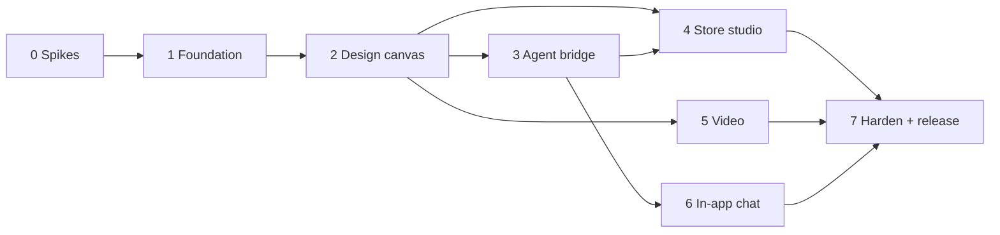

# Roadmap

> **Status: Design.** Phase 0 has not started. This page is the decision log from day one; every deviation from it is recorded here by the PR that causes it.

## Goal

A native app (macOS, Windows, Linux; Rust core under a Qt 6 C++/QML shell) where the user designs store and web assets and short videos, and guides their own coding agents by selecting, pinning notes and editing by hand, with every agent edit visible and reversible. Installing the app installs a skill and a local MCP endpoint for the agents on the machine.

## Principles

1. **Prove the risky parts first.** The canvas and video preview on Qt, the Rust–Qt bridge, and the agent bridge can each invalidate the plan. They go before any breadth.
2. **Vertical slice early.** "Open a project, drag a device frame, let Claude Code move it from a pinned note, export a validated App Store PNG" before the rest.
3. **The core stands alone.** Everything works headless before it works in a window.
4. **Operations are the product.** The UI, MCP and CLI are ways to author them.

## Overview

Phases 4 and 5 are independent after Phase 2/3 and can run in parallel.

## Phase 0: spikes

Throwaway code, results written into the wiki; exit when each question has an answer with numbers.

| Spike | Question | Exit criterion |
|-------|----------|----------------|
| Canvas on Qt | Draw 10,000 mixed nodes with pan/zoom at ≥ 60 fps on a mid-range laptop? Options: `render` output as a texture, a custom scene-graph/`QRhi` item, `QQuickPaintedItem` as a baseline ([Qt Desktop](./qt-desktop.md#canvas-rendering)) | Frame-time numbers for each on macOS; pick one |
| Text | One shaping engine for canvas and export: Qt's text stack or a Rust shaper in `render` (design-grade kerning, OpenType features, variable fonts, per-run styles) | A paragraph with runs matches a reference render on canvas and in export |
| Video surface | Play 1080p30 H.264 through Qt Multimedia (`QVideoSink`/`VideoOutput`) and through frames from our own decode; one FFmpeg in the process ([Video Editing](./video-editing.md#qt-multimedia-and-ffmpeg)) | Dropped-frame count and CPU/GPU load on macOS |
| Rust–Qt bridge | `cxx-qt` (CMake-driven C++ app linking Rust crates) versus a plain C ABI (`cbindgen`); build on macOS, Windows, Linux | A QML list model backed by `core` builds and runs on all three; pick one; exception entry in the decision log |
| MCP loopback | `127.0.0.1` HTTP MCP server with token and Host/Origin checks, in-process with the Qt app (Rust `agent` crate); connect Claude Code and Codex CLI | Both agents list and call a test tool; a browser `fetch` is rejected |
| Skill installer | For each of Claude Code, Codex CLI, Gemini CLI, opencode, Cursor: where do user-level skills go, does it scan `~/.agents/skills/`? | Verified table replaces `[INFERENCE]` rows in [Agent Integration](./agent-integration.md#target-table) |
| File format | SVG-native versus JSON; deterministic serialization; round trip of 5,000 nodes | Pick one ([Document Format](./document-format.md#open-questions)) |
| Licensing guard | A CMake component allowlist plus a CI check that fails on any GPL-only Qt module or GPL-only dependency; QML build flow does not pull in the GPL-only Qt Qml Compiler | Check fails on a seeded violation ([Qt Desktop](./qt-desktop.md#licensing)) |

**Performance budgets** (checked by benchmarks from Phase 1; change only with a decision-log entry): canvas interaction frame time ≤ 16 ms at 10k nodes; cold start to interactive ≤ 1 s on the reference machine; operation apply + checkpoint ≤ 5 ms for a 100-op transaction; export of a 1320×2868 frame ≤ 500 ms; timeline scrub latency ≤ 100 ms. Reference machine to be named in Phase 0.

## Phase 1: foundation

Cargo workspace (`core`, `render`, `store`, `agent`, `bridge`, `cli`) plus the CMake project for `app/`, pinned Qt and `cxx-qt`, CMake presets, CI (`cargo fmt`/`clippy -D warnings`/`test`, `clang-format`, CMake build and `ctest`, `cargo deny`, the Qt licensing guard, on macOS, Windows and Linux), `core` node model + operations + history + project I/O with round-trip tests, empty editor window with panel layout and theme, `opendesigner` CLI that opens, validates and exports a trivial project. **Exit:** a project round-trips byte-identically; CLI exports a PNG; app opens it on all three OSes.

**Progress (2026-11-19), headless half done.** Built and passing: the Cargo workspace (`core`, `render`, `store`, `cli`), `core` (node model, operations, history, checkpoints, project I/O with byte-identical round trip), `render` (CPU rasterizer for frames, groups, rectangles, ellipses with strokes, rounded corners, clipping and opacity; PNG export, RGB or RGBA), `store` (nine built-in presets with validation) and the `opendesigner` CLI (`new`, `show`, `apply`, `checkpoint`, `restore`, `export --preset`, `validate`, `presets`). Not started: `agent`, `bridge`, the Qt/CMake shell (blocked on installing Qt; the maintainer's disk had under 3 GB free), text and image rendering, the Qt licensing guard, and CI for C++. The Phase 1 exit criteria "project round-trips byte-identically" and "CLI exports a PNG" are met and tested; "app opens it on all three OSes" is not.

## Phase 2: design canvas

Frames, primitives, paths with the pen tool, text, images, selection/transform/snapping, layers panel, inspector, tokens, auto layout, components and instances, undo/redo from the operation log, PNG/SVG/PDF export. **Exit:** reproduce a real GitNotēs store slide by hand; golden tests pass on all three OSes.

## Phase 3: agent bridge

`agent` crate: MCP server and tool surface, `get_guidance`, selection and annotation model and UI (pins), attributed operations with agent-change outlines and checkpoints, skill generator and installer with the verified target table, connect-command UX. **Exit:** with Claude Code and Codex CLI, a user pins "headline too small" on a text node, the agent reads the pin, resizes, resolves it; the layer is outlined; restore brings the old size back. Installer tests prove it writes only inside its directories.

## Phase 4: store studio

`store` crate: presets with sources and dates, device frames, panorama mode and slicing, localization overrides, capture import, `validate_export`, app icon set generator, web presets. **Exit:** regenerate GitNotēs' iPhone 6.9" set and OpenMedia's panorama in OpenDesigner and pass validation; compare to the script output programmatically for size/format (not by eye).

## Phase 5: video

`media` crate with the pinned FFmpeg toolchain, composition and timeline model, preview, trim/split/ripple, text and overlay clips including design frames, export presets and validation, timeline annotations and agent timeline operations. **Exit:** produce a 30 s app preview from a screen capture with a title card, exported to a validated App Store preview spec.

## Phase 6: in-app chat

ACP client, agent picker for installed agents, chat panel with tool calls, plans and approvals inline, guidance context attached to each prompt, scripted demo agent for tests, session list. **Exit:** the Phase 3 scenario without leaving the app.

## Phase 7: harden and release

Accessibility and IME pass, crash-safe autosave and recovery, Qt deployment per OS with LGPL compliance (dynamic Qt, license texts, relinking path, Qt attribution), signing and notarization (macOS), installers (Windows, Linux), update channel decision, codec patent/royalty review for H.264 and similar ([Video Editing](./video-editing.md#qt-multimedia-and-ffmpeg)), docs and sample projects, a security review against [Security](./security.md), `cargo deny`. Pricing and distribution are **undecided** (see below).

## Open questions

- **Pricing and distribution.** GitNotēs and OpenMedia have paid tiers through stores; a desktop editor's model (free and open, paid cloud-free Pro, store distribution) is not decided. Whatever is chosen must keep open files and local-first ([AGENTS.md invariants 1, 8](../../AGENTS.md)).
- **One rasterizer or two.** Share `render` between export and the canvas, or let the canvas use a scene-graph/`QRhi` item and test equivalence. Phase 0 canvas spike.
- **Docking and component kit.** QML `SplitView` and our own panel manager, since KDDockWidgets is GPL-only ([Qt Desktop](./qt-desktop.md#licensing)); scope of a custom Qt Quick Controls style. Phase 0.
- **Plugins and scripting.** OpenCut plans both; we defer. Not before the operation API is stable.
- **Code-driven motion.** Kino uses Remotion. If we ever need it, it must be sandboxed and approved per project (invariant 3).
- **Collaboration.** Git-based sharing only for now.
- **Penpot/Figma import.** Only if requested.

## Decision log

| Date | Decision | Why |
|------|----------|-----|
| 2026-11-19 | Build a native GUI for agent-guided asset creation instead of continuing to script store art through a CLI agent | Text-only guidance is the bottleneck ([Architecture](./architecture.md#the-problem-this-solves)) |
| 2026-11-19 | UI toolkit: **Qt 6 (C++/QML)**, over GPUI (first choice, dropped the same day) | The canvas and video preview are custom rendering under any toolkit; Qt supplies the surrounding problems (text input/IME, accessibility, native dialogs and menus, high-DPI, playback, packaging) that GPUI leaves to us, and GPUI is pre-1.0 with a young widget set. Costs: two languages, LGPL obligations, heavier distribution ([Qt Desktop](./qt-desktop.md#why-qt)) |
| 2026-11-19 | Core crates never import Qt; the Qt app, MCP server and CLI share operations; C++/QML hold presentation only | OpenCut's principle; headless and testable; keeps the toolkit replaceable |
| 2026-11-19 | Integrate agents through an Agent Skill plus a local MCP server, installed by the app | Skills carry taste, MCP carries capability; Kino, Penpot and Figma validate MCP; `.agents/skills/` is the cross-client convention |
| 2026-11-19 | Agent edits are attributed operations with checkpoints, outlined in the UI | Kino's model; makes agent output reviewable and reversible |
| 2026-11-19 | Documents are data, not code | Security and agent legibility ([invariant 3](../../AGENTS.md)); differs from Kino/Remotion |
| 2026-11-19 | Keep MPL-2.0 (already in the repository) | Matches GitNotēs and OpenMedia; Qt is used under LGPLv3 (dynamic linking), which is compatible; OpenCut (MIT) is a compatible input |
| 2026-11-19 | Documentation system copied from GitNotēs/OpenMedia: wiki-first `AGENTS.md`, `CHANGELOG.md`, `docs/wiki/` synced to the GitHub Wiki, worktrees | Proven in both projects |
| 2026-11-19 | Logo is `assets/logo.svg`; brand ramp taken from it | Maintainer's choice |
| 2026-11-19 | Qt stays LGPL: allowlisted modules only, no GPL-only Qt modules or GPL-only libraries (KDDockWidgets, Qt Canvas Painter, …) | MPL-2.0 project; GPL-only code would force GPL ([invariant 12](../../AGENTS.md), [Qt Desktop](./qt-desktop.md#licensing)) |
| 2026-11-19 | Dependency policy: only popular, well-maintained packages; exceptions are logged here ([AGENTS.md](../../AGENTS.md#dependencies)) | Smaller audit surface, less abandonment risk |
| 2026-11-19 | **Exception:** `cxx-qt` (KDAB) as the Rust–Qt bridge, pending the Phase 0 bridge spike | Evidence read 2026-11-19: KDAB-maintained, MIT or Apache-2.0, release 0.10.0 on 2026-08-24, but pre-1.0 and modest adoption (about 211k total downloads, 7 dependents on crates.io), so it is below the "popular" bar. Alternatives: plain C ABI with `cbindgen`, which is the exit plan if `cxx-qt` is abandoned or the spike fails |
| 2026-11-19 | Phase 1 core uses sRGB hex colors, typed `set` properties, document-minted ids and an in-memory undo stack; text and image nodes exist in the model but are reported as warnings by `render` | Smallest design that satisfies the Phase 1 exit; each is listed with its migration path in [Document Format](./document-format.md#implemented-cratescore) |
| 2026-11-19 | Store presets ship with `Verification::CopiedFromReference`; the CLI prints a note until a preset is read against its primary source | The rules came from GitNotēs' notes, not from Apple/Google pages; invariant 9 requires saying so |
